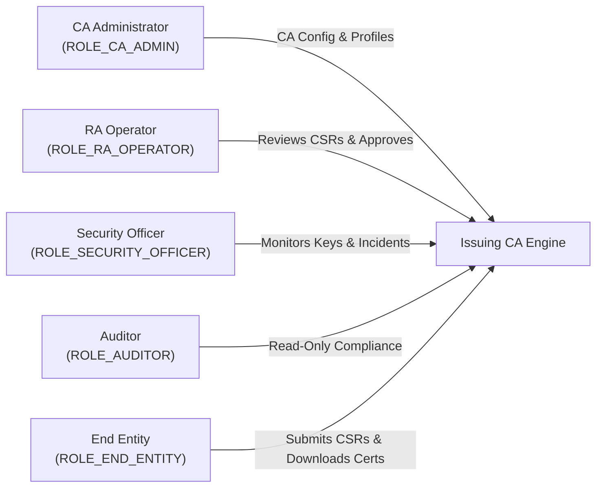

# PKI Issuing Certificate Authority System

[](docs/phase-1/01-project-charter.md)
[](README.md#6-phase-2-quick-start--verification-guide)
[](docs/phase-3/implementation-report.md)
[](docs/phase-4/implementation-report.md)
[](backend/pom.xml)
[](frontend/package.json)
[](README.md)
[](docs/phase-1/06-data-model.md)
[](docs/phase-1/09-threat-model-and-security-requirements.md)

---

## 1. Executive Summary & Project Purpose

The **PKI Issuing Certificate Authority System** is an enterprise-grade, web-based cryptographic service designed to issue, manage, validate, and revoke standard X.509 v3 digital certificates. Operating as a Subordinate (Issuing) CA within a formal Public Key Infrastructure hierarchy, the system enforces:

- **Hardware-Protected Private Keys:** The CA private signing key is generated inside a PKCS#11 cryptographic token boundary (SoftHSM2 for development/testing, physical HSM for production) and is **strictly non-exportable** (`CKA_EXTRACTABLE=false`). At no point does the CA private key exist in plaintext in database records, logs, or application memory.
- **Client Key Sovereignty:** End Entity private keys are generated strictly on the client device and are **never** transmitted to the CA. Only PKCS#10 Certificate Signing Requests (CSRs) with proof-of-possession signatures are processed.
- **Enforced Separation of Duties:** Strict Role-Based Access Control (RBAC) across five primary roles (`CA_ADMIN`, `RA_OPERATOR`, `SECURITY_OFFICER`, `AUDITOR`, `END_ENTITY`), preventing self-approval and unilateral rogue certificate issuance.
- **Standards Compliance:** Full alignment with RFC 5280 (X.509 PKI Profile), RFC 6960 (OCSP), RFC 2986 (PKCS#10), and NIST SP 800-57 key management guidelines.
- **Tamper-Evident Auditing:** Every security-relevant event is recorded in an immutable, append-only audit trail chained via `HMAC-SHA256` signatures.

---

## 2. Technology Stack

| Domain | Technology | Version | Rationale & Architectural Role |
| :--- | :--- | :--- | :--- |
| **Backend Runtime** | Java OpenJDK | 21 LTS | Enterprise stability, Virtual Threads, modern language features. |
| **Backend Framework** | Spring Boot | 3.3.x | Spring Web, Spring Security 6, Spring Data JPA, Actuator. |
| **Frontend Framework** | Vue 3 + TypeScript | 3.4+ / TS 5.x | Reactive UI, strict typing, maintainable component design. |
| **Frontend Tooling** | Vite | 5.x | Instant development HMR, optimized ESM bundling. |
| **State Management** | Pinia | 2.x | Lightweight, type-safe authentication and session state. |
| **Database** | MySQL Server | 8.0 / 8.4 LTS | ACID transactions, B-Tree serial indexing, InnoDB engine. |
| **Database Migrations**| Flyway | 10.x | Version-controlled, reproducible SQL schema migrations. |
| **Cryptographic Library**| Bouncy Castle | 1.78+ (`bcpkix-jdk18on`) | ASN.1 codec, PKCS#10 CSR parsing, X.509 v3 builders. |
| **Development HSM** | SoftHSM2 via SunPKCS11 | v2.6.x | PKCS#11 v2.40 standard token emulator for Dev and CI. |
| **Testing** | JUnit 5, Mockito, Vitest, Playwright | Latest LTS | Comprehensive test pyramid across unit, security, integration, and E2E. |
| **Containerization** | Docker & Docker Compose | Compose v2 | Reproducible multi-container stack (App, DB, SoftHSM fixture). |

---

## 3. Five Primary Stakeholder Roles



1. **CA Administrator (`ROLE_CA_ADMIN`):** Configures CA operating parameters, certificate profiles, system settings, and user accounts.
2. **RA Operator (`ROLE_RA_OPERATOR`):** Inspects applicant identities, validates CSR attributes, and formally approves or rejects enrollment requests (self-approval prohibited).
3. **Security Officer (`ROLE_SECURITY_OFFICER`):** Oversees cryptographic key lifecycle, monitors high-priority security audit events, and authorizes emergency revocations.
4. **Auditor (`ROLE_AUDITOR`):** Strictly read-only access to audit logs, issuance history, revocation records, and cryptographic hash-chain verification.
5. **End Entity (`ROLE_END_ENTITY`):** Submits client-generated CSRs, tracks approval status, downloads issued certificates and chains, and requests revocation for owned certificates.

---

## 4. Repository Structure & Phase Organization

```
.
├── README.md                                    # Root Project Overview & Orientation
├── docs/
│   └── phase-1/                                 # Phase 1: Complete System Blueprint & Design Baseline
│       ├── 01-project-charter.md                # Mission, objectives, scope, and governance
│       ├── 02-srs.md                            # Complete Software Requirements Specification
│       ├── 03-assumptions-and-open-questions.md # Technical assumptions, trade-offs, and open items
│       ├── 04-stakeholders-and-rbac.md          # 5-role taxonomy, SoD rules, and endpoint permissions
│       ├── 05-system-architecture.md            # Modular monolith, layer design, and HSM adapter
│       ├── 06-data-model.md                     # Normalized MySQL schema, data dictionary, ERD
│       ├── 07-api-contracts.md                  # REST OpenAPI specifications and protocol contracts
│       ├── 08-workflows-and-state-machines.md   # 12 operational workflows and finite state machines
│       ├── 09-threat-model-and-security-requirements.md # STRIDE analysis, PKI mitigations, key rules
│       ├── 10-nonfunctional-requirements.md     # Measurable performance, availability, and RTO/RPO
│       ├── 11-acceptance-criteria-and-test-strategy.md # Traceable ACs and multi-tier test pyramid
│       ├── 12-development-roadmap.md            # 10-phase roadmap with explicit MVP boundaries
│       ├── 13-requirements-traceability-matrix.md # Full RTM mapping requirements to tests & phases
│       ├── 14-decisions-and-risks.md            # Architecture Decision Records (ADRs) & Risk Register
│       └── diagrams/                            # Raw Mermaid diagram sources
│           ├── system-architecture.mmd          # Modular monolith component architecture
│           ├── deployment-diagram.mmd           # Docker Compose container deployment topology
│           ├── entity-relationship-diagram.mmd  # Relational database entity relationships
│           ├── issuance-sequence.mmd            # End-to-end certificate issuance sequence flow
│           ├── certificate-lifecycle.mmd        # FSM states for enrollment and certificate life
│           ├── revocation-crl-sequence.mmd      # Revocation and CRL publication flow
│           └── trust-boundaries.mmd             # Network, application, and HSM security enclaves
├── backend/                                     # [Planned Phase 2] Spring Boot 3 Modular Monolith
│   ├── pom.xml
│   └── src/
└── frontend/                                    # [Planned Phase 2] Vue 3 + TypeScript SPA
    ├── package.json
    └── src/
```

---

## 5. Ten-Phase Development Roadmap

| Phase | Title | Focus Area | Status | Deliverables |
| :---: | :--- | :--- | :---: | :--- |
| **1** | **Requirements, Architecture & Design** | System design baseline, SRS, data model, APIs, threat model | **COMPLETED** | Complete `docs/phase-1/` documentation suite |
| **2** | **Project Setup, DB Foundation & RBAC** | Spring Boot 3, Vue 3, Flyway, MySQL, JWT Auth, RBAC filters | **COMPLETED** | Backend modular core, Flyway V1/V2, 5-role RBAC, Vue SPA, 43 passed tests |
| **3** | **RA Registration & CSR Processing** | Bouncy Castle CSR parser, proof-of-possession, RA review queue | Planned | CSR ingestion, SoD self-approval checks, RA UI |
| **4** | **CA Issuance & Certificate Profiles** | Profile engine, CSPRNG serials, X.509 v3 builder, cert download | Planned | Working certificate issuance & download |
| **5** | **Renewal, Revocation & Repository** | RFC 5280 revocation, renewal workflows, personal dashboard | Planned | Revocation with reason codes, renewal requests |
| **6** | **SoftHSM Integration & Key Protection** | SunPKCS11 provider, SoftHSM2 container, CA key generation | Planned | Zero CA key in memory/DB; token-backed signing |
| **7** | **Validation, CRL & OCSP Services** | Signed X.509 v2 CRLs, path validation API, RFC 6960 OCSP responder | Planned | Automated CRL publication, live OCSP endpoint |
| **8** | **Administration, Audit & Notifications** | Chained HMAC audit log, auditor tool, user CRUD, health metrics | Planned | Tamper-evident audit verification, admin console |
| **9** | **Integration, Security & DR Testing** | E2E Playwright tests, OWASP scan, load test, backup/restore test | Planned | Confirmed RPO <= 1h, RTO <= 4h, test reports |
| **10**| **Deployment, Docs & Demonstration** | Multi-container Docker Compose, user manuals, recorded demo | Planned | Production-ready containerized release |

---

## 6. Phase 2 Quick Start & Verification Guide

### Prerequisites
- **JDK 21 LTS** (Eclipse Adoptium or OpenJDK 21)
- **Node.js 20+ / 24+** and **npm 10+**
- **Docker & Docker Compose** (for local MySQL 8.0 container)

### Step 1: Start Database (Local Dev)
```bash
docker compose up -d
```
*Health check validates MySQL 8.0 on port 3306 with UTF-8 MB4 character set.*

### Step 2: Run Backend Service
```bash
cd backend
mvnw.cmd spring-boot:run
```
*The Spring Boot application starts on port 8080. Flyway automatically runs migrations (`V1__init_auth_schema.sql`, `V2__seed_roles_and_admin.sql`), creates tables, and seeds the 5 primary RBAC roles.*

### Step 3: Run Frontend Single-Page App
```bash
cd frontend
npm install
npm run dev
```
*Vite dev server starts on `http://localhost:5173` with reverse proxy to `http://localhost:8080/api/v1`.*

### Step 4: Run Automated Tests
```bash
# Run 77 Backend Integration, Security & SoftHSM PKCS#11 Tests (JUnit 5 + Spring Boot Test)
cd backend
mvnw.cmd test

# Run 23 Frontend Store, Component & API Client Tests (Vitest)
cd frontend
npm run test:unit

# Verify Frontend Production Build (Typecheck + Vite bundle)
npm run build
```

### SoftHSM2 Development Token Setup
For live cryptographic operations via PKCS#11 during local development:
```bash
# Initialize development token (Slot 1)
softhsm2-util --init-token --slot 0 --label "PKIToken" --pin 123456 --so-pin 87654321
softhsm2-util --init-token --free-slot --label "PkiIssuingCaTestToken" --pin 123456 --so-pin 87654321
```
Environment variables:
- `PKI_HSM_ENABLED=true`
- `PKI_HSM_LIBRARY_PATH=C:/SoftHSM2/lib/softhsm2-x64.dll` (or `/usr/lib/softhsm/libsofthsm2.so` on Linux)
- `PKI_HSM_SLOT_INDEX=1`
- `PKI_HSM_TOKEN_PIN=123456`

### Seed Evaluation Personas
For rapid local evaluation, default test users are provisioned:
| Persona / Role | Username | Initial Password | Permitted Endpoints Scope |
| :--- | :--- | :--- | :--- |
| **CA Administrator** | `admin` | `ChangeMe123!` | `/admin/**`, `/auth/me`, User CRUD, CA init |
| **RA Operator** | `ra_operator` | `ChangeMe123!` | `/auth/me`, CSR reviews, `/api/v1/ca/requests/{id}/issue` |
| **Security Officer** | `sec_officer` | `ChangeMe123!` | `/auth/me`, Dual-approval (Phase 3), Certificates search |
| **Auditor** | `auditor` | `ChangeMe123!` | `/auth/me`, Read-only inspection (Phase 4 & Phase 8) |
| **End Entity** | `end_entity` | `ChangeMe123!` | `/auth/me`, CSR submission, `/api/v1/certificates/my` |

---

## 7. Phase 1 Document Index

Detailed design blueprints are available in the [`docs/phase-1/`](docs/phase-1/) directory:

- [Project Charter](docs/phase-1/01-project-charter.md) — Scope, governance, and business objectives.
- [Software Requirements Specification (SRS)](docs/phase-1/02-srs.md) — Traceable functional and cryptographic requirements.
- [Assumptions & Open Questions](docs/phase-1/03-assumptions-and-open-questions.md) — Operating context and trade-offs.
- [Stakeholders & RBAC Architecture](docs/phase-1/04-stakeholders-and-rbac.md) — Five primary roles and permission matrix.
- [System Architecture](docs/phase-1/05-system-architecture.md) — Hexagonal modular monolith and HSM integration.
- [Data Model & ERD](docs/phase-1/06-data-model.md) — Normalized MySQL 8 relational schema and data dictionary.
- [REST API Contracts](docs/phase-1/07-api-contracts.md) — OpenAPI endpoint schemas, status codes, and OCSP protocol.
- [Workflows & State Machines](docs/phase-1/08-workflows-and-state-machines.md) — 12 operational workflows and lifecycle FSMs.
- [Threat Model & Security Requirements](docs/phase-1/09-threat-model-and-security-requirements.md) — STRIDE analysis and key protection rules.
- [Non-Functional Requirements](docs/phase-1/10-nonfunctional-requirements.md) — Measurable performance targets and RPO/RTO.
- [Acceptance Criteria & Test Strategy](docs/phase-1/11-acceptance-criteria-and-test-strategy.md) — Acceptance criteria and testing pyramid.
- [Ten-Phase Development Roadmap](docs/phase-1/12-development-roadmap.md) — Implementation schedule and MVP boundaries.
- [Requirements Traceability Matrix](docs/phase-1/13-requirements-traceability-matrix.md) — Complete bidirectional traceability matrix.
- [Decisions & Risks](docs/phase-1/14-decisions-and-risks.md) — Architecture Decision Records (ADRs) and risk register.

### Implementation Reports
- [Phase 3 Implementation Report](docs/phase-3/implementation-report.md) — RA Workflow, CSR PoP Verification, Profile Policy & Review Queue.
- [Phase 4 Implementation Report](docs/phase-4/implementation-report.md) — CA Signing Engine, SoftHSM PKCS#11 Integration, X.509 Construction & Repository.

---

## 8. Project Phase Status & Definition of Done

- **Phase 1 (Requirements & Architecture):** COMPLETE.
- **Phase 2 (Project Setup, Database Foundation, Authentication & RBAC):** COMPLETE & VERIFIED.
- **Phase 3 (Registration Authority Workflow & Policy Enforcement):** COMPLETE & VERIFIED (56/56 backend, 18/18 frontend tests passed).
- **Phase 4 (CA Cryptographic Signing Engine & Certificate Repository):** COMPLETE & VERIFIED (77/77 backend, 23/23 frontend tests passed, SoftHSM token signing active).

Ready for stakeholder review before commencing Phase 5 (Certificate Lifecycle & Revocation Management).
