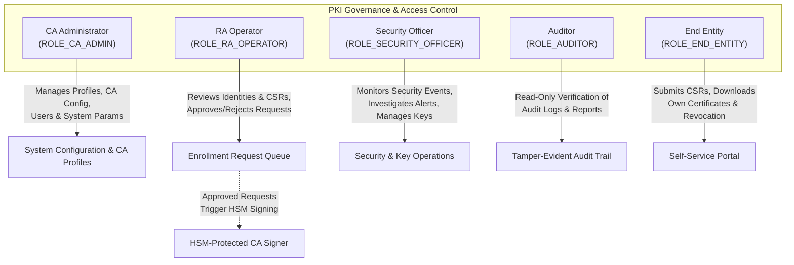

# Project Charter: PKI Issuing Certificate Authority System

## 1. Document Control
- **Document ID:** DOC-CHARTER-001
- **Project Name:** PKI Issuing Certificate Authority (CA) System
- **Phase:** Phase 1 — Requirements Analysis, System Design, Architecture, and Development Planning
- **Status:** Approved / Design Baseline
- **Classification:** Internal / Engineering Blueprint
- **Version:** 1.0.0
- **Authors:** Senior Software Architect, PKI Security Architect, Database Designer, Technical Lead

---

## 2. Executive Summary & Purpose
The objective of this project is to architect, design, implement, and validate a secure, production-grade, web-based **Public Key Infrastructure (PKI) Issuing Certificate Authority (CA) System**. 

Modern enterprise security and Zero Trust architectures depend fundamentally on cryptographic identities for authentication, encryption, and digital signatures. The PKI Issuing CA System acts as a subordinate (issuing) authority within an established trust hierarchy, managing the complete lifecycle of digital certificates for end entities (servers, workstations, network appliances, services, and users).

The system enforces strict registration authority (RA) validation, cryptographic policy enforcement, role-based access control (RBAC), multi-party separation of duties, tamper-evident audit logging, hardware-enforced private key isolation via PKCS#11, and automated revocation services (Certificate Revocation Lists [CRLs] and Online Certificate Status Protocol [OCSP]).

---

## 3. Mission & Strategic Objectives

| ID | Strategic Objective | Target Outcome |
| :--- | :--- | :--- |
| **OBJ-01** | **Cryptographic Identity Lifecycle Management** | Deliver complete end-to-end management for X.509 v3 certificates: CSR submission, automated validation, authorized RA approval, HSM-backed issuance, renewal, revocation, and status checking. |
| **OBJ-02** | **Hardware-Protected CA Private Keys** | Ensure the Issuing CA private signing key is generated and stored exclusively within a PKCS#11 cryptographic token (SoftHSM for development/testing, physical HSM for production), never existing in plaintext in memory, databases, configuration files, or logs. |
| **OBJ-03** | **Enforced Separation of Duties (SoD)** | Guarantee that no single individual possesses end-to-end unilateral capability to configure the CA, approve certificate requests, issue certificates, and review or tamper with security audit records. |
| **OBJ-04** | **Standard-Compliant Interoperability** | Ensure complete compliance with RFC 5280 (X.509 PKI Profile), RFC 6960 (OCSP), RFC 2986 (PKCS#10 CSR), RFC 5958 (Asymmetric Key Packages), and NIST SP 800-57 key management guidelines. |
| **OBJ-05** | **Modular, Maintainable Architecture** | Implement a clean, well-bounded modular monolith using Spring Boot 3, Vue 3, MySQL 8, and Bouncy Castle, designed for straightforward horizontal scaling and eventual cloud/on-premise deployment. |

---

## 4. Project Scope

### 4.1 In-Scope (Phase 1 through Phase 10)
1. **Subordinate / Issuing CA Operations:** Operation as an intermediate CA certified by an offline root CA or parent trust anchor.
2. **Registration Authority (RA) Workflow:** Certificate Signing Request (CSR) parsing, public key extraction, cryptographic signature verification, subject identity validation, domain/SAN validation, and policy compliance checking.
3. **Approval Workflows:** Multi-role workflow supporting submission, review, approval, rejection, and cancellation with complete attribution.
4. **Certificate Issuance & Profiles:** Issuance of RFC 5280 compliant X.509 v3 certificates tailored by configurable profiles (TLS Server, TLS Client, Code Signing, S/MIME, Dual-Use).
5. **Cryptographic Protection:** Java Cryptography Architecture (JCA) abstraction layer integrating Bouncy Castle and SunPKCS11 provider targeting SoftHSM v2 (dev/test) and physical HSMs (prod).
6. **Revocation & Validation:** RFC 5280 CRL generation, scheduled and on-demand publication, direct X.509 chain verification, and RFC 6960 OCSP responder integration.
7. **Security & Auditing:** Five-role RBAC, Spring Security integration, immutable and tamper-evident audit event logging, secure administrative controls, and session protection.
8. **Administration & Monitoring:** System configuration, health endpoints (Spring Actuator), HSM status monitoring, and database backup/restore procedures.
9. **User Interfaces:** Modern, responsive Vue 3 Single Page Application (SPA) supporting all five primary roles according to their permission boundaries.

### 4.2 Minimum Viable Product (MVP) Scope (Phases 1–7 + Core of Phase 8)
- Authentication and five primary RBAC roles (`CA_ADMIN`, `RA_OPERATOR`, `SECURITY_OFFICER`, `AUDITOR`, `END_ENTITY`).
- User enrollment and PKCS#10 CSR validation (RSA and ECDSA).
- RA operator review, approval, and rejection workflow.
- HSM-backed certificate issuance via SoftHSM using predefined profiles (TLS Server, TLS Client).
- Certificate retrieval, chain download (PEM, PKCS#7), and certificate search.
- Certificate renewal workflow (manual and automated eligibility checks).
- Certificate revocation workflow with RFC 5280 reason codes.
- Scheduled and manual CRL generation signed by the CA key in the HSM.
- Basic RFC 5280 certificate chain validation endpoint.
- Comprehensive, append-only security audit event recording.
- Baseline MySQL backup and restoration protocol.

### 4.3 Explicitly Deferred / Post-MVP Scope
- **Time Stamping Authority (TSA):** RFC 3161 timestamping service deferred to Phase 8+.
- **Enterprise Directory Synchronization:** Automatic LDAP / Active Directory identity synchronization.
- **SIEM Streaming Integration:** Live Syslog / CEF / Splunk forwarding (file-based structured JSON logging provided initially).
- **Automated ACME / SCEP / EST Protocols:** RFC 8555 (ACME) or RFC 7030 (EST) automated enrollment endpoints.
- **Multi-Instance HSM Clustering:** Active-active multi-datacenter physical HSM clustering.
- **Smart Card / PIV Card Issuance:** Physical smart card personalization and minidriver integration.

---

## 5. Stakeholder Roles & Governance

The system enforces five primary Role-Based Access Control (RBAC) personas with strict separation of duties:

1. **CA Administrator (`ROLE_CA_ADMIN`):** Configures CA settings, certificate profile templates, system parameters, and user account provisioning. Cannot unilaterally approve CSRs or perform signing.
2. **RA Operator (`ROLE_RA_OPERATOR`):** Inspects applicant identities, validates CSR attributes, and approves or rejects enrollment requests. Cannot modify CA profiles, cannot alter audit logs, and cannot approve their own requests.
3. **Security Officer (`ROLE_SECURITY_OFFICER`):** Oversees key lifecycle state, supervises key ceremonies, monitors security alerts, and manages authorized security policies. Cannot sign certificates or approve routine issuance.
4. **Auditor (`ROLE_AUDITOR`):** Possesses strictly read-only access to audit logs, issuance history, revocation logs, and system reports. Has zero modification or operational privileges.
5. **End Entity (`ROLE_END_ENTITY`):** Authenticated user or device identity that submits CSRs, tracks request status, downloads issued certificates and chains, and requests revocation of their own certificates.

---

## 6. Technology Stack Baseline

| Tier / Component | Technology Selected | Version / Spec | Justification & Architectural Role |
| :--- | :--- | :--- | :--- |
| **Backend Runtime** | Java OpenJDK | 21 LTS | Enterprise stability, Virtual Threads (Project Loom), modern language features, robust long-term support. |
| **Backend Framework** | Spring Boot | 3.3.x | Industry standard framework providing Spring Web, Spring Security, Spring Data JPA, and Spring Boot Actuator. |
| **Database** | MySQL Server | 8.0 / 8.4 LTS | ACID compliance, robust indexing, relational constraints for certificate serials, UTF8MB4 support. |
| **Database Migrations**| Flyway | 10.x | Versioned, repeatable, automated database schema migrations. |
| **Frontend Framework** | Vue 3 + TypeScript | 3.4+ / TS 5.x | Reactive UI, strong typing, maintainable component architecture, rapid rendering. |
| **Frontend Tooling** | Vite | 5.x | Ultra-fast development server, optimized ESM bundling, zero-overhead build pipeline. |
| **State Management** | Pinia | 2.x | Light, modular, type-safe store for authentication state and user sessions. |
| **Cryptographic Library**| Bouncy Castle | 1.78+ (bcprov / bcpkix) | Complete X.509, PKCS#10, PKCS#7, OCSP, and ASN.1 codec support for Java. |
| **Development HSM** | SoftHSM2 via SunPKCS11 | v2.6.x | Standards-compliant PKCS#11 software token provider for local development, CI, and test execution. |
| **API Contract & Docs** | OpenAPI / Swagger | 3.0 / SpringDoc 2.x | Formal REST specification, interactive testing console, contract generation. |
| **Testing Frameworks** | JUnit 5, Mockito, Vitest, Playwright | Latest LTS | Comprehensive test pyramid: unit, integration, crypto-mock, browser E2E. |
| **Containerization** | Docker & Docker Compose | Compose v2 | Reproducible multi-container local runtime (App, MySQL, SoftHSM test fixture). |

---

## 7. Assumptions & Operating Context
1. **Workspace State:** The project repository is starting as a greenfield workspace. No existing legacy source code or prior conflicting configuration was present.
2. **Trust Model:** The Issuing CA is assumed to operate as a Subordinate CA whose certificate is issued and signed by a trusted Offline Root CA. Generating the initial CA certificate signing request (Subordinate CA CSR) and importing the parent Root-signed certificate is part of system initialization.
3. **SoftHSM Boundary:** SoftHSM2 is used strictly for development, automated testing, and functional demonstrations. It establishes the exact PKCS#11 API abstraction and integration patterns required for commercial physical HSMs (e.g., Thales Luna, Utimaco, AWS CloudHSM) without claiming physical tamper resistance in development.
4. **End Entity Key Generation:** End entity private keys are **never** generated on or transmitted to the CA server. The client generates their own key pair locally and submits only a PKCS#10 Certificate Signing Request containing their public key and proof-of-possession signature.

---

## 8. Phase 1 Deliverables Summary
The Phase 1 delivery encompasses the complete technical architecture and engineering specification suite stored in `docs/phase-1/`:
1. `01-project-charter.md` — Project mission, scope, governance, and objectives.
2. `02-srs.md` — Comprehensive Software Requirements Specification with traceable IDs.
3. `03-assumptions-and-open-questions.md` — Technical assumptions, trade-offs, and open items.
4. `04-stakeholders-and-rbac.md` — Persona profiles, endpoint-level permission matrix, and SoD rules.
5. `05-system-architecture.md` — Modular monolith architecture, component design, HSM integration, and diagrams.
6. `06-data-model.md` — Normalized relational database schema, data dictionary, and ER diagram.
7. `07-api-contracts.md` — Complete REST API contract specifications, schemas, error formats, and protocols.
8. `08-workflows-and-state-machines.md` — End-to-end operational workflows, state machines, and edge cases.
9. `09-threat-model-and-security-requirements.md` — STRIDE threat modeling, attack vector analysis, and mitigations.
10. `10-nonfunctional-requirements.md` — Measurable targets for performance, scalability, availability, and observability.
11. `11-acceptance-criteria-and-test-strategy.md` — Test pyramid, automated testing framework, and validation criteria.
12. `12-development-roadmap.md` — 10-phase implementation plan, prerequisites, deliverables, and exit gates.
13. `13-requirements-traceability-matrix.md` — Full traceability matrix linking requirements to design, code, tests, and roadmap.
14. `14-decisions-and-risks.md` — Architecture Decision Records (ADRs) and comprehensive Risk Register.
15. `diagrams/` — Raw Mermaid source files for architecture, deployment, ERD, sequence flows, and state machines.
16. `README.md` — Root repository orientation, stack summary, phase status, and design index.

---

## 9. Sign-off and Gate Criteria to Phase 2
Transition from Phase 1 (Design Baseline) to Phase 2 (Project Setup, Database Foundation, Authentication, and RBAC) requires satisfaction of the following exit criteria:
- [x] All 14 foundational design documents and Mermaid diagrams generated, cross-referenced, and validated.
- [x] Traceable requirement IDs assigned across functional, cryptographic, security, HSM, validation, non-functional, compliance, audit, and recovery domains.
- [x] Relational schema and entity constraints validated against business workflows and cryptographic requirements.
- [x] API specifications verified against RBAC roles, permission matrix, and state transitions.
- [x] Threat model mitigations mapped to explicit acceptance criteria and automated tests.
- [x] MVP boundaries clearly delineated from post-MVP enhancements.
