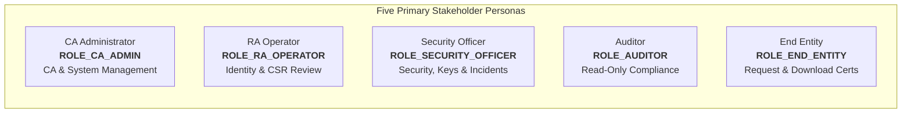
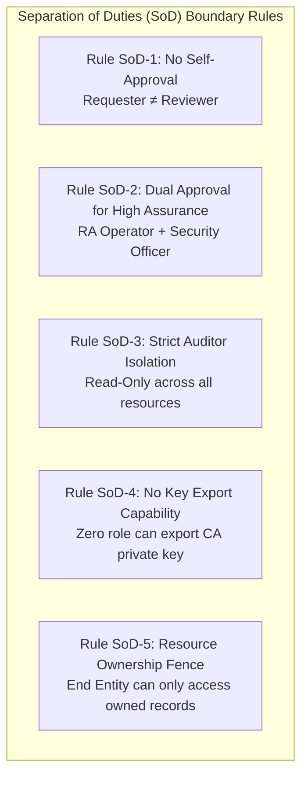
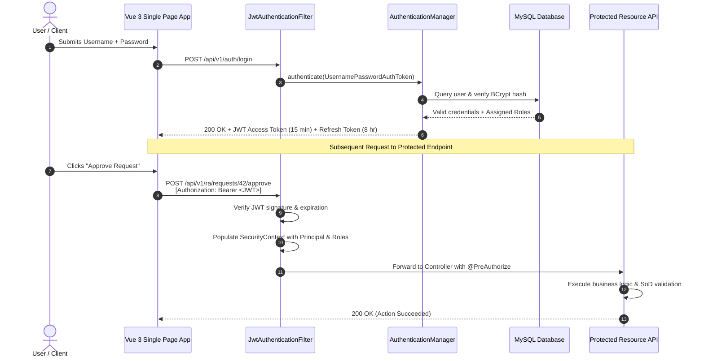

# Stakeholders, Personas, and RBAC Architecture
## PKI Issuing Certificate Authority System

- **Document ID:** DOC-RBAC-004
- **Phase:** Phase 1 — Requirements Analysis, System Design, Architecture, and Development Planning
- **Status:** Approved / Design Baseline
- **Version:** 1.0.0
- **Classification:** Highly Confidential / Security Design

---

## 1. Governance Principles & Unified Application Architecture

The PKI Issuing Certificate Authority System implements a **Unified Multi-Role Web Architecture**. The five stakeholder roles do not run as isolated disconnected applications; instead, all users access a single cohesive system backed by:
1. A unified Spring Boot REST API enforcing fine-grained role-based security (`@PreAuthorize`) and resource ownership checks on every endpoint.
2. A single Vue 3 Single Page Application (SPA) that dynamically tailors its navigation, dashboards, and action controls based on the authenticated user's verified privileges.
3. Strict enforcement of **Separation of Duties (SoD)** to prevent unilateral abuse of cryptographic power.

---

## 2. Five Primary Stakeholder Personas

### 2.1 CA Administrator (`ROLE_CA_ADMIN`)
- **Profile:** Senior systems engineer or PKI administrator responsible for the operational readiness and configuration of the PKI platform.
- **Responsibilities:**
  - Configures CA operating parameters, CRL publication schedules, and system settings.
  - Creates, modifies, and activates/deactivates Certificate Profiles.
  - Provisions, updates, and manages user accounts and role assignments.
  - Initiates and manages system database backups and maintenance routines.
- **Explicit Boundary:** Cannot unilaterally review and approve standard CSR enrollment requests (must not overlap with daily RA verification), cannot alter audit records, and cannot export private keys.

### 2.2 Registration Authority (RA) Operator (`ROLE_RA_OPERATOR`)
- **Profile:** Identity validation specialist or helpdesk officer responsible for vetting applicants and validating certificate enrollment requests against organizational policy.
- **Responsibilities:**
  - Inspects pending enrollment requests in the RA queue.
  - Validates applicant organizational standing, domain ownership, and SAN justifications.
  - Verifies CSR cryptographic integrity and public key parameter compliance.
  - Formally approves or rejects enrollment requests with logged justification comments.
- **Explicit Boundary:** Cannot approve enrollment requests submitted by themselves (Self-Approval Prohibition). Cannot modify CA signing configuration or certificate profiles. Cannot delete certificates or tamper with audit logs.

### 2.3 Security Officer (`ROLE_SECURITY_OFFICER`)
- **Profile:** Corporate information security officer or cryptographic officer responsible for security governance, key custody, incident response, and compliance oversight.
- **Responsibilities:**
  - Supervises cryptographic key generation ceremonies and token slot configurations.
  - Monitors high-priority security audit events, failed authentication spikes, and anomaly alerts.
  - Investigates security incidents and authorizes emergency certificate revocations (e.g., in cases of key compromise).
  - Participates in dual-control approval for high-assurance certificate issuance.
- **Explicit Boundary:** Does not perform day-to-day routine certificate issuance or system account management. Possesses no ability to bypass audit logging.

### 2.4 Auditor (`ROLE_AUDITOR`)
- **Profile:** Internal compliance auditor, external PKI assessor, or risk management officer.
- **Responsibilities:**
  - Inspects the complete chronological audit trail of all PKI actions.
  - Verifies the cryptographic HMAC hash-chain integrity of audit records.
  - Reviews historical certificate issuance, revocation, and administrative activity.
  - Exports verifiable audit reports in CSV and JSON formats for external compliance reporting.
- **Explicit Boundary:** **Strictly Read-Only**. The Auditor role has zero write, update, approval, or execution privileges across any functional endpoint.

### 2.5 End Entity (`ROLE_END_ENTITY`)
- **Profile:** Enterprise employee, DevOps engineer, system administrator, or automated service account requesting digital certificates for systems, servers, or devices.
- **Responsibilities:**
  - Generates cryptographic key pairs locally on client systems.
  - Submits PKCS#10 CSRs and required identity attributes via the portal or API.
  - Tracks status of submitted requests (Pending, Approved, Issued, Rejected).
  - Downloads issued certificates, intermediate CA certificates, and full chains.
  - Submits renewal requests and requests revocation of their own certificates.
- **Explicit Boundary:** Bound strictly by **Resource Ownership Rules**. Can view and download only certificates and requests associated with their own user identity. Cannot access administrative, RA, security, or audit interfaces.

---

## 3. Secondary Technical Identities

In addition to human roles, the system defines carefully controlled technical identities:

| Technical Identity | Authentication Mechanism | Purpose & Scope |
| :--- | :--- | :--- |
| **`SYSTEM_SCHEDULER`** | Internal Spring Security Context (`SecurityContextHolder`) | Internal execution of automated cron jobs: scheduled CRL generation, certificate expiration sweeps, and database health probes. Cannot be invoked externally via HTTP. |
| **`OCSP_CLIENT`** | Unauthenticated / Anonymous HTTP Client | Public RFC 6960 endpoint client requesting revocation status for specific certificate serial numbers. Limited strictly to `/api/v1/ocsp/**`. |
| **`PUBLIC_CRL_CLIENT`** | Unauthenticated / Anonymous HTTP Client | Public HTTP client downloading published CRL files from `/api/v1/crl/**` or static distribution points. |
| **`HEALTH_MONITOR`** | Basic Auth / Dedicated Token (`ROLE_MONITORING`) | External uptime monitoring system (e.g., Prometheus / Kubernetes liveness probe) querying `/actuator/health` and `/actuator/prometheus`. |

---

## 4. Separation of Duties (SoD) Rules Matrix

Separation of duties is an essential control to mitigate insider threats and unauthorized certificate issuance:

| SoD Rule ID | Rule Definition | Enforcement Mechanism |
| :--- | :--- | :--- |
| **SoD-01** | **No Self-Approval** | The system rejects any approval attempt if `request.requesterId == currentAuthenticatedUser.id`. (Throws `AccessDeniedException`). |
| **SoD-02** | **Approval vs. Signing Separation** | Cryptographic signing is an automated internal subsystem operation executed only upon verified approval state. An RA Operator cannot directly trigger HSM signing without passing through approval state persistence. |
| **SoD-03** | **Dual-Person Control (High-Assurance)** | Certificates flagged under high-assurance profiles (e.g., Subordinate CAs, Code Signing) require two independent signatures: first by an RA Operator, second by a Security Officer before signing occurs. |
| **SoD-04** | **Auditor Immutability** | Database user for standard application queries does not have `UPDATE` or `DELETE` grants on the `audit_events` table. Auditor role in Spring Security has no `POST`, `PUT`, `DELETE` grants. |
| **SoD-05** | **Zero Key Export** | No role (including CA Administrator) has an API endpoint or UI action to retrieve CA private key bytes. Keys are generated inside the HSM with `CKA_EXTRACTABLE=false`. |
| **SoD-06** | **Resource Ownership Isolation** | End Entity queries for requests or certificates automatically include `WHERE requester_id = :userId` in the JPA repository query. |

---

## 5. Granular Privilege Taxonomy

The system defines atomic privilege tokens combined into roles:

| Domain | Privilege Token | Description |
| :--- | :--- | :--- |
| **Authentication** | `auth:login` | Authenticate to system and receive JWT |
| | `auth:refresh` | Refresh expired access token using refresh token |
| **CA Configuration** | `ca:read` | View CA operational status, certificate, and chain |
| | `ca:init` | Initialize CA key pair and submit CA CSR |
| | `ca:import` | Import root-signed intermediate CA certificate |
| | `ca:config:write` | Update CA parameters (CRL schedule, validity rules) |
| **Certificate Profiles** | `profile:read` | View available certificate profiles |
| | `profile:write` | Create or update certificate profiles |
| **Enrollment** | `enroll:submit` | Submit a new PKCS#10 CSR enrollment request |
| | `enroll:read:own` | View enrollment requests submitted by oneself |
| | `enroll:read:all` | View all enrollment requests across all users |
| **RA Workflow** | `ra:review` | Inspect request details and run verification checks |
| | `ra:approve` | Approve an enrollment request for issuance |
| | `ra:reject` | Reject an enrollment request with logged reasons |
| **Issuance** | `cert:issue` | Trigger cryptographic signing of approved requests |
| | `cert:download:own`| Download certificates belonging to the requester |
| | `cert:download:all`| Download any issued certificate |
| **Renewal** | `cert:renew:own` | Request renewal for owned certificates |
| | `cert:renew:all` | Initiate renewal for any certificate |
| **Revocation** | `cert:revoke:own` | Request revocation of owned certificate |
| | `cert:revoke:all` | Authorize emergency revocation of any certificate |
| **CRL & OCSP** | `crl:read` | Download published CRLs |
| | `crl:generate` | Manually trigger out-of-band CRL generation |
| | `ocsp:query` | Submit OCSP status queries |
| **Auditing** | `audit:read` | Query and inspect security audit events |
| | `audit:export` | Export audit trail to CSV/JSON |
| **System Admin** | `admin:users:read` | View user accounts and role assignments |
| | `admin:users:write`| Provision, update, or disable user accounts |
| | `admin:backup:run` | Trigger database backup routine |
| | `admin:system:read`| View system health and HSM diagnostics |

---

## 6. Comprehensive Role-to-Privilege Matrix

| Privilege Token | CA Admin | RA Operator | Security Officer | Auditor | End Entity | Anonymous / Public |
| :--- | :---: | :---: | :---: | :---: | :---: | :---: |
| `auth:login`, `auth:refresh` |  Yes |  Yes |  Yes |  Yes |  Yes |  Yes |
| `ca:read` |  Yes |  Yes |  Yes |  Yes |  Yes |  Yes (Cert/Chain only) |
| `ca:init`, `ca:import` |  Yes | No | No | No | No | No |
| `ca:config:write` |  Yes | No | No | No | No | No |
| `profile:read` |  Yes |  Yes |  Yes |  Yes |  Yes | No |
| `profile:write` |  Yes | No | No | No | No | No |
| `enroll:submit` |  Yes |  Yes |  Yes | No |  Yes | No |
| `enroll:read:own` |  Yes |  Yes |  Yes | No |  Yes | No |
| `enroll:read:all` |  Yes |  Yes |  Yes |  Yes | No | No |
| `ra:review`, `ra:approve`, `ra:reject` |  Yes (Except self) |  Yes (Except self) |  Yes (Dual control) | No | No | No |
| `cert:issue` |  Yes |  Yes (Auto-trigger) | No | No | No | No |
| `cert:download:own` |  Yes |  Yes |  Yes |  Yes |  Yes | No |
| `cert:download:all` |  Yes |  Yes |  Yes |  Yes | No |  Yes (Public certs) |
| `cert:renew:own` |  Yes |  Yes |  Yes | No |  Yes | No |
| `cert:renew:all` |  Yes |  Yes | No | No | No | No |
| `cert:revoke:own` |  Yes |  Yes |  Yes | No |  Yes | No |
| `cert:revoke:all` |  Yes |  Yes |  Yes | No | No | No |
| `crl:read` |  Yes |  Yes |  Yes |  Yes |  Yes |  Yes |
| `crl:generate` |  Yes | No |  Yes | No | No | No |
| `ocsp:query` |  Yes |  Yes |  Yes |  Yes |  Yes |  Yes |
| `audit:read`, `audit:export` | No (Self excluded) | No |  Yes |  Yes | No | No |
| `admin:users:read`, `write` |  Yes | No | No | No | No | No |
| `admin:backup:run` |  Yes | No | No | No | No | No |
| `admin:system:read` |  Yes | No |  Yes |  Yes | No | No |

---

## 7. Endpoint-Level RBAC Enforcement Matrix

| HTTP Method | API Path | Minimum Role Required | Specific Authorization Rule |
| :--- | :--- | :--- | :--- |
| `POST` | `/api/v1/auth/login` | Permitted to all | Rate-limited (5/min per IP) |
| `POST` | `/api/v1/auth/refresh` | Permitted to all | Requires valid, unexpired refresh token |
| `GET` | `/api/v1/auth/me` | Authenticated | Returns current profile & authorities |
| `POST` | `/api/v1/auth/logout` | Authenticated | Revokes refresh token in database |
| `GET` | `/api/v1/ca` | Authenticated | CA status and public metadata |
| `GET` | `/api/v1/ca/certificate` | Permitted to all | Public CA X.509 certificate |
| `GET` | `/api/v1/ca/chain` | Permitted to all | Complete public intermediate + root chain |
| `POST` | `/api/v1/ca/init` | `ROLE_CA_ADMIN` | Generates CA key in HSM & outputs CSR |
| `POST` | `/api/v1/ca/import-cert` | `ROLE_CA_ADMIN` | Imports signed intermediate certificate |
| `GET` | `/api/v1/profiles` | Authenticated | Lists active certificate profiles |
| `POST` | `/api/v1/profiles` | `ROLE_CA_ADMIN` | Creates new certificate profile |
| `PUT` | `/api/v1/profiles/{id}` | `ROLE_CA_ADMIN` | Updates profile extensions/rules |
| `POST` | `/api/v1/enrollment/requests` | `ROLE_END_ENTITY`, `ROLE_RA_OPERATOR`, `ROLE_CA_ADMIN` | Submits PKCS#10 CSR. Assigns `requester_id = currentUserId` |
| `GET` | `/api/v1/enrollment/requests/my` | `ROLE_END_ENTITY` | Filtered strictly to `requester_id = currentUserId` |
| `GET` | `/api/v1/enrollment/requests` | `ROLE_RA_OPERATOR`, `ROLE_CA_ADMIN`, `ROLE_SECURITY_OFFICER`, `ROLE_AUDITOR` | View all pending & processed requests |
| `GET` | `/api/v1/enrollment/requests/{id}`| `ROLE_RA_OPERATOR`, `ROLE_CA_ADMIN`, `ROLE_SECURITY_OFFICER`, `ROLE_AUDITOR` OR Request Owner | Cross-tenant access blocked |
| `POST` | `/api/v1/ra/requests/{id}/approve` | `ROLE_RA_OPERATOR`, `ROLE_CA_ADMIN` | Blocked if `request.requesterId == currentUserId` |
| `POST` | `/api/v1/ra/requests/{id}/reject` | `ROLE_RA_OPERATOR`, `ROLE_CA_ADMIN` | Requires rejection comment |
| `POST` | `/api/v1/ca/requests/{id}/issue` | `ROLE_RA_OPERATOR`, `ROLE_CA_ADMIN` | Triggers HSM signing of approved request |
| `GET` | `/api/v1/certificates` | `ROLE_RA_OPERATOR`, `ROLE_CA_ADMIN`, `ROLE_SECURITY_OFFICER`, `ROLE_AUDITOR` | Paginated search of all certificates |
| `GET` | `/api/v1/certificates/my` | `ROLE_END_ENTITY` | Returns only certificates owned by user |
| `GET` | `/api/v1/certificates/{serial}` | Authenticated OR Permitted | Details of certificate |
| `GET` | `/api/v1/certificates/{serial}/download`| Permitted to all | Downloads public X.509 PEM / DER / PKCS#7 |
| `POST` | `/api/v1/certificates/{serial}/renew` | `ROLE_END_ENTITY` (if owner), `ROLE_RA_OPERATOR`, `ROLE_CA_ADMIN` | Creates renewal enrollment request |
| `POST` | `/api/v1/certificates/{serial}/revoke`| `ROLE_END_ENTITY` (if owner), `ROLE_RA_OPERATOR`, `ROLE_SECURITY_OFFICER`, `ROLE_CA_ADMIN` | Revokes certificate with reason code |
| `GET` | `/api/v1/crl/latest` | Permitted to all | Downloads latest published CRL file |
| `POST` | `/api/v1/crl/generate` | `ROLE_CA_ADMIN`, `ROLE_SECURITY_OFFICER` | Manually triggers immediate CRL regeneration |
| `POST` | `/api/v1/validation/verify-cert` | Permitted to all | Verifies path, expiry, and revocation |
| `POST` / `GET` | `/api/v1/ocsp/**` | Permitted to all | RFC 6960 binary OCSP responder |
| `GET` | `/api/v1/audit/events` | `ROLE_AUDITOR`, `ROLE_SECURITY_OFFICER` | Paginated query of immutable audit log |
| `GET` | `/api/v1/audit/reports/export` | `ROLE_AUDITOR` | Exports signed CSV/JSON audit report |
| `GET` / `POST` | `/api/v1/admin/users/**` | `ROLE_CA_ADMIN` | User account lifecycle management |
| `POST` | `/api/v1/admin/backups/create` | `ROLE_CA_ADMIN` | Executes database backup procedure |
| `GET` | `/actuator/health` | Permitted / Monitored | Liveness, readiness, HSM session status |

---

## 8. Authentication & Session Security Architecture

1. **Password Hashing:** Passwords are encrypted using BCrypt with a cost factor of 12.
2. **Access Tokens:** Signed with HMAC-SHA256 using a securely generated 256-bit secret key or RSA private key. The token includes `sub` (username), `userId`, `roles`, `iat`, and `exp` (15 minutes).
3. **Refresh Tokens:** High-entropy random tokens stored in the `user_tokens` database table. Valid for 8 hours. Revocable on logout or security alert.
4. **CORS & CSRF:** Strict CORS policy allowing only authorized frontend origins. Cross-Site Request Forgery is mitigated using stateless Bearer authentication in standard HTTP `Authorization` headers.
