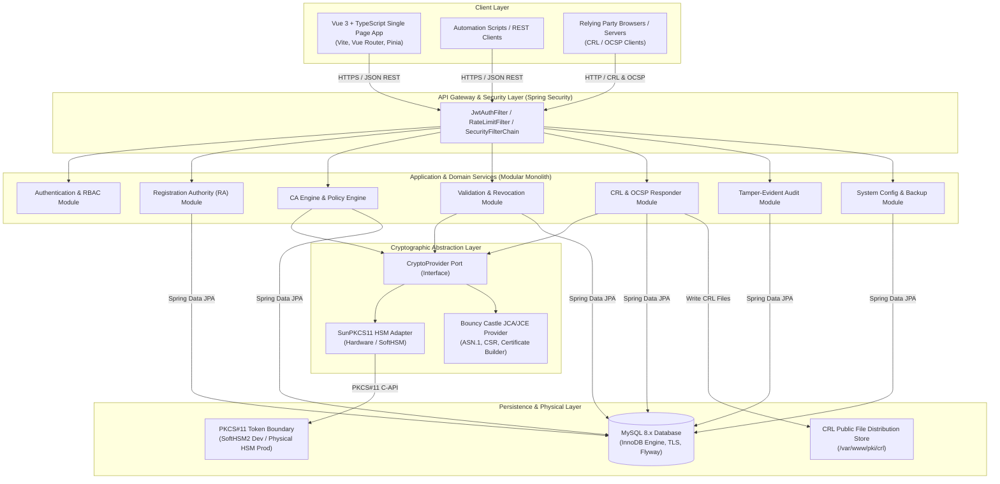
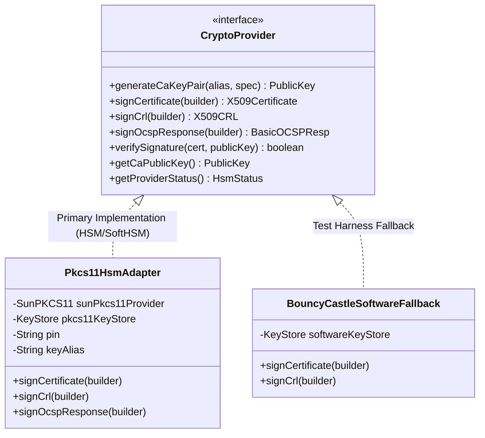
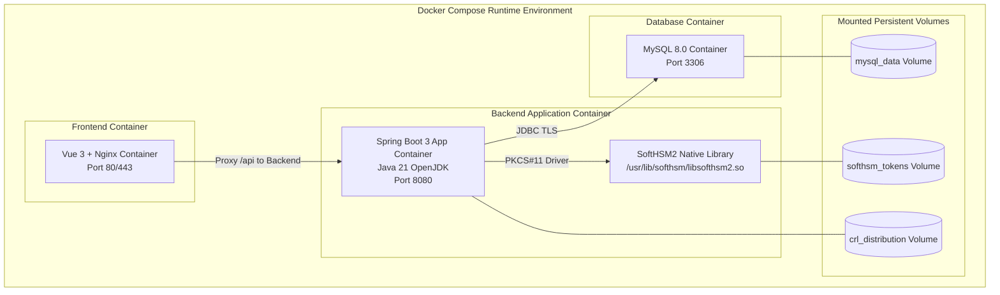

# System Architecture & Technical Design
## PKI Issuing Certificate Authority System

- **Document ID:** DOC-ARCH-005
- **Phase:** Phase 1 — Requirements Analysis, System Design, Architecture, and Development Planning
- **Status:** Approved / Architecture Baseline
- **Version:** 1.0.0
- **Classification:** Engineering Specification

---

## 1. Architectural Strategy & Modular Monolith Pattern

The PKI Issuing Certificate Authority System is designed as a **Hexagonal / Clean Modular Monolith**. 

### Why a Modular Monolith?
1. **Cryptographic Transaction Consistency:** Issuing a certificate requires strict atomicity across validation, HSM signing, database recording, and audit trail chaining. Microservices would require complex two-phase commits (2PC) or distributed saga patterns that introduce race conditions and failure windows during private key signing.
2. **Minimal Attack Surface:** An issuing CA must have a strictly minimized and hardened perimeter. Running distributed microservices expands the attack surface with inter-service networking, service discovery, and mutual TLS mesh overhead.
3. **Strict Domain Boundaries:** While bundled in a single deployment artifact, the codebase enforces strict package-level decoupling and clean interfaces between domain modules (e.g., `crypto`, `ca`, `ra`, `validation`, `audit`, `security`).



---

## 2. Layered Architecture Specification

### 2.1 Presentation Tier (Vue 3 Single Page Application)
- **Framework:** Vue 3 Composition API (`<script setup>`) with TypeScript.
- **Build Tool:** Vite 5 for instant HMR and optimized production bundles.
- **Routing & State:** Vue Router 4 with route navigation guards verifying user roles; Pinia 2 for reactive auth/session state.
- **UI Components:** Clean, responsive Vanilla CSS design system with curated dark/light palettes, glassmorphism accents, and accessible form controls.
- **Security:** Strict XSS prevention (contextual DOM rendering without `v-html`), automatic JWT injection via Axios interceptors, and immediate state clearing on logout.

### 2.2 REST API & Transport Tier (Spring Web & Security)
- **Spring Security 6.x:** Stateless `SecurityFilterChain` with custom `JwtAuthenticationFilter`, `RateLimitingFilter`, and security headers (HSTS, CSP, X-Frame-Options, X-Content-Type-Options).
- **Controllers:** REST controllers annotated with `@RestController`, `@RequestMapping("/api/v1/...")`, and granular `@PreAuthorize("hasAuthority('...')")`.
- **Validation:** Input payload validation using Spring Bean Validation (`@Valid`, `@NotNull`, `@Size`, `@Pattern`).
- **Error Handling:** Centralized `@RestControllerAdvice` mapping domain exceptions to RFC 7807 standard Problem Details JSON payloads.

### 2.3 Application & Workflow Service Tier
- **`EnrollmentService`:** Orchestrates CSR ingestion, proof-of-possession verification, attribute extraction, and profile eligibility checks.
- **`RaApprovalService`:** Coordinates review queues, approval state transitions, and enforces separation-of-duties rules.
- **`CaIssuanceService`:** Binds approved requests to cryptographic signing operations, calculates random serial numbers, and persists issued certificates.
- **`CertificateProfileService`:** Evaluates certificate requests against profile constraints (EKU, key usage, validity limits).
- **`RevocationService`:** Processes revocation requests, records RFC 5280 reason codes, and updates revocation indexes.
- **`CrlService`:** Compiles active revocation entries, formats X.509 v2 CRLs, triggers HSM signing, and publishes CRL files.
- **`OcspService`:** Decodes RFC 6960 binary OCSP requests, evaluates database certificate status, and returns signed OCSP responses.
- **`AuditService`:** Records append-only, tamper-evident security audit events and computes chained HMAC-SHA256 signatures.

### 2.4 Domain Tier
- Pure Java domain models: `EnrollmentRequest`, `Certificate`, `CertificateProfile`, `RevocationRecord`, `CrlRecord`, `AuditEvent`, `CaAuthority`.
- Finite state machines enforcing deterministic transitions (`RequestStatus`, `CertificateStatus`, `RevocationStatus`).
- Domain Events: `CertificateIssuedEvent`, `CertificateRevokedEvent`, `CrlPublishedEvent`, `SecurityAlertEvent` dispatched synchronously via Spring's `ApplicationEventPublisher`.

### 2.5 Cryptographic Abstraction Tier
The cryptographic subsystem isolates hardware dependencies behind clean Java interfaces:



### 2.6 Persistence & Infrastructure Tier
- **Spring Data JPA & Hibernate:** ORM mapping to normalized MySQL tables.
- **Flyway:** Versioned database migrations (`V1__init_schema.sql`, `V2__seed_profiles.sql`).
- **Connection Pool:** HikariCP with optimized pooling, connection timeout, and leak detection.

---

## 3. Hardware Security Module (HSM) Integration Architecture

### 3.1 SunPKCS11 Configuration Architecture
The application connects to SoftHSM2 (development) or a physical HSM (production) using Java's built-in `SunPKCS11` provider via dynamic registration:

```
+--------------------------------------------------------------------+
| Application JVM (Java 21)                                          |
|                                                                    |
|  +--------------------+         +-------------------------------+  |
|  | CaIssuanceService  |         | CryptoProvider (Java Interface)|  |
|  +---------+----------+         +---------------+---------------+  |
|            |                                    |                  |
|            v                                    v                  |
|  +----------------------------------------------+---------------+  |
|  | Pkcs11HsmAdapter                                             |  |
|  | - Calls JCA/JCE KeyStore.getInstance("PKCS11", sunProvider)   |  |
|  | - Retrieves PrivateKey reference (Handle only, no key bytes) |  |
|  +------------------------------+-------------------------------+  |
|                                 |                                  |
|                                 v                                  |
|  +--------------------------------------------------------------+  |
|  | sun.security.pkcs11.SunPKCS11 Provider                       |  |
|  | Reads pkcs11.cfg (slot / library path)                        |  |
|  +------------------------------+-------------------------------+  |
+---------------------------------|----------------------------------+
                                  | JNI (Java Native Interface)
                                  v
+--------------------------------------------------------------------+
| Operating System & Token Boundary                                  |
|                                                                    |
|  +--------------------------------------------------------------+  |
|  | PKCS#11 Shared Library (.so / .dll)                           |  |
|  | SoftHSM: libsofthsm2.so  |  Thales Luna: libCryptoki2_64.so  |  |
|  +------------------------------+-------------------------------+  |
|                                 | C-API Calls                      |
|                                 v                                  |
|  +--------------------------------------------------------------+  |
|  | Secure Cryptographic Token Boundary (Protected Storage)       |  |
|  | - Token Slot 0 (PIN Authenticated)                           |  |
|  | - CA Private Key Object: CKA_PRIVATE=TRUE, CKA_SENSITIVE=TRUE|  |
|  |                          CKA_EXTRACTABLE=FALSE               |  |
|  +--------------------------------------------------------------+  |
+--------------------------------------------------------------------+
```

### 3.2 Key Protection Invariant
At no point during the lifecycle of the CA is the private key un-wrapped or exported into Java heap memory. The `PrivateKey` object returned by the Java PKCS11 `KeyStore` is an opaque pointer (`SunPKCS11$P11PrivateKey`) holding only the internal PKCS#11 object handle (`CK_OBJECT_HANDLE`). Cryptographic operations delegate directly to the hardware token.

---

## 4. Trust Boundaries & Security Enclaves

```mermaid
graph TB
    subgraph "Untrusted Public Network"
        UserBrowser["User Web Browser"]
        ClientService["Client Servers / Systems"]
    end

    subgraph "Demilitarized Zone (DMZ) / Reverse Proxy"
        Nginx["Reverse Proxy / TLS Terminator<br/>(Nginx / Envoy)"]
    end

    subgraph "Application Trust Enclave (Secure LAN)"
        AppServer["Spring Boot PKI Issuing CA Application<br/>(REST API, Workflows, Policy Engine)"]
    end

    subgraph "Data Storage Enclave"
        MySQLNode[("MySQL 8.x Database<br/>(Encrypted Tablespace, TLS)")]
        CRLVolume["Public File System<br/>(/var/www/pki/crl)"]
    end

    subgraph "Hardware Security Enclave"
        HSMDevice["PKCS#11 Token Boundary<br/>(SoftHSM2 Dev / Physical HSM Prod)"]
    end

    UserBrowser -->|TLS 1.3 / HTTPS (Port 443)| Nginx
    ClientService -->|TLS 1.3 / HTTPS (Port 443)| Nginx
    
    Nginx -->|Mutual TLS / HTTP (Port 8443)| AppServer
    
    AppServer -->|TLS Encrypted JDBC (Port 3306)| MySQLNode
    AppServer -->|File System Write| CRLVolume
    AppServer -->|Direct PKCS#11 C-API| HSMDevice
```

### Trust Boundary Rules
1. **Boundary 1 (Client to Proxy):** All traffic must traverse TLS 1.3/1.2. Public clients may access `/api/v1/crl/**` and `/api/v1/ocsp/**` without authentication. All other endpoints require valid bearer tokens.
2. **Boundary 2 (Proxy to Application):** Reverse proxy forwards real client IP via `X-Forwarded-For` and `X-Real-IP`. Application validates headers for rate limiting and audit attribution.
3. **Boundary 3 (Application to Database):** MySQL connection requires authenticated TLS (`requireSSL=true`). Database is inaccessible from public networks.
4. **Boundary 4 (Application to HSM):** Isolated C-API communication via PKCS#11. The HSM token boundary rejects any command attempting to read raw private key attributes.

---

## 5. Deployment Architecture



---

## 6. Failure Modes, Resiliency, & Recovery

| Failure Scenario | Detection Mechanism | System Behavior & Mitigation | Recovery Action |
| :--- | :--- | :--- | :--- |
| **HSM Token Disconnection** | `PKCS11Exception` (e.g., `CKR_DEVICE_REMOVED`, `CKR_SESSION_CLOSED`) | Active signing operations fail gracefully. System transitions CA status to `DEGRADED`. Enrollment requests remain in `APPROVED` state. | Automated connection pool retry with exponential backoff. Admin alert dispatched. |
| **Database Unavailability** | `CannotCreateTransactionException`, Hikari pool exhaustion | API returns HTTP 503 Service Unavailable. In-flight requests rollback. | Container restart / MySQL service failover. Actuator health reports `DOWN`. |
| **Concurrent Duplicate Approval** | Optimistic locking exception (`@Version` mismatch) | Second concurrent approval attempt fails with HTTP 409 Conflict. | UI displays conflict message; duplicate issuance prevented. |
| **Corrupted Audit Record** | HMAC hash-chain verification failure | Auditor dashboard flags record ID and halts chain verification at point of tampering. | Incident investigation launched; historical DB backup cross-referenced. |
| **CRL Generation Failure** | Scheduled task exception | Error logged; previously published valid CRL remains active until its `nextUpdate` expires. | Alarm triggered to CA Admin; retry task scheduled within 15 minutes. |
