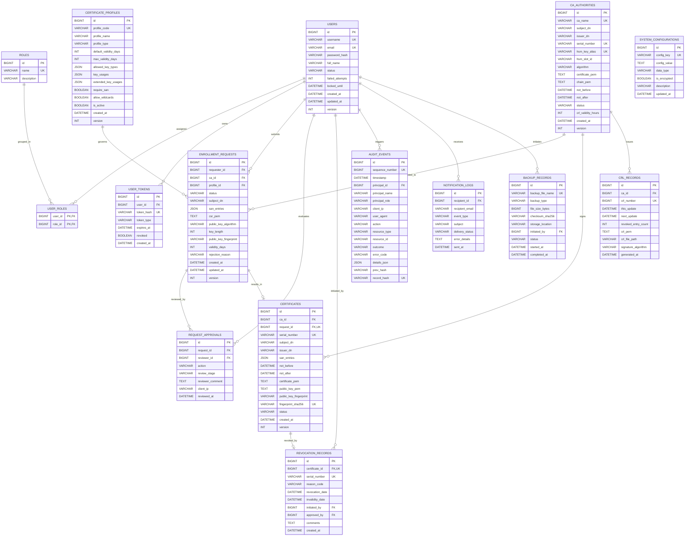

# Relational Data Model & Database Architecture
## PKI Issuing Certificate Authority System

- **Document ID:** DOC-DATA-006
- **Phase:** Phase 1 — Requirements Analysis, System Design, Architecture, and Development Planning
- **Status:** Approved / Data Architecture Baseline
- **Version:** 1.0.0
- **Classification:** Highly Confidential / Data Architecture

---

## 1. Data Architecture Principles

1. **Strict Relational Normalization:** Third Normal Form (3NF) across all operational entities, enforcing relational integrity through foreign keys, not-null constraints, and unique indices.
2. **Cryptographic Key Segregation:** **ZERO CA private keys in the database**. The database schema strictly prohibits any column, table, or attribute intended to store CA private keys.
3. **Optimistic Locking & Concurrency:** High-concurrency entities (`enrollment_requests`, `certificates`, `ca_authorities`) implement an integer `version` field managed by Hibernate optimistic locking to eliminate race conditions.
4. **Append-Only Tamper-Evident Auditing:** The `audit_events` table contains an unbroken cryptographic hash chain where each row embeds `HMAC-SHA256(prev_hash + row_data)`. No application API or user has `UPDATE` or `DELETE` grants.
5. **High-Performance Certificate Lookup:** Natural certificate serial numbers (hexadecimal strings) are indexed with unique constraints and binary representations for sub-millisecond OCSP and CRL evaluation.

---

## 2. Entity-Relationship Diagram (ERD)

---

## 3. Comprehensive Data Dictionary

### 3.1 `USERS` & Identity Tables

#### Table: `users`
Stores user and administrative accounts.

| Column Name | SQL Data Type | Constraints | Description |
| :--- | :--- | :--- | :--- |
| `id` | `BIGINT AUTO_INCREMENT` | `PK`, `NOT NULL` | Surrogate primary key |
| `username` | `VARCHAR(64)` | `UNIQUE`, `NOT NULL` | Unique login username |
| `email` | `VARCHAR(128)` | `UNIQUE`, `NOT NULL` | User contact email |
| `password_hash`| `VARCHAR(255)` | `NOT NULL` | BCrypt password hash (cost factor >= 12) |
| `full_name` | `VARCHAR(128)` | `NOT NULL` | Display name of user |
| `status` | `VARCHAR(20)` | `NOT NULL`, Default `'ACTIVE'` | Account status: `ACTIVE`, `LOCKED`, `DISABLED` |
| `failed_attempts`| `INT` | `NOT NULL`, Default `0` | Consecutive failed authentication count |
| `locked_until` | `DATETIME` | `NULL` | Lockout expiration timestamp |
| `created_at` | `DATETIME` | `NOT NULL` | Timestamp record created |
| `updated_at` | `DATETIME` | `NOT NULL` | Timestamp record last modified |
| `version` | `INT` | `NOT NULL`, Default `0` | Optimistic locking counter |

*Indexes:*
- `idx_users_username` (`username`)
- `idx_users_email` (`email`)
- `idx_users_status` (`status`)

#### Table: `roles`
Stores RBAC role definitions.

| Column Name | SQL Data Type | Constraints | Description |
| :--- | :--- | :--- | :--- |
| `id` | `BIGINT AUTO_INCREMENT` | `PK`, `NOT NULL` | Surrogate primary key |
| `name` | `VARCHAR(32)` | `UNIQUE`, `NOT NULL` | Role name (e.g., `ROLE_CA_ADMIN`, `ROLE_RA_OPERATOR`) |
| `description` | `VARCHAR(255)` | `NOT NULL` | Human-readable role explanation |

#### Table: `user_roles`
Join table mapping users to roles.

| Column Name | SQL Data Type | Constraints | Description |
| :--- | :--- | :--- | :--- |
| `user_id` | `BIGINT` | `PK`, `FK` -> `users(id)` | Foreign key to user |
| `role_id` | `BIGINT` | `PK`, `FK` -> `roles(id)` | Foreign key to role |

#### Table: `user_tokens`
Stores revocable refresh tokens.

| Column Name | SQL Data Type | Constraints | Description |
| :--- | :--- | :--- | :--- |
| `id` | `BIGINT AUTO_INCREMENT` | `PK`, `NOT NULL` | Surrogate primary key |
| `user_id` | `BIGINT` | `FK` -> `users(id)`, `NOT NULL` | Associated user identity |
| `token_hash` | `VARCHAR(64)` | `UNIQUE`, `NOT NULL` | SHA-256 hash of refresh token |
| `token_type` | `VARCHAR(20)` | `NOT NULL` | Type: `REFRESH_TOKEN` |
| `expires_at` | `DATETIME` | `NOT NULL` | Token expiration timestamp |
| `revoked` | `BOOLEAN` | `NOT NULL`, Default `FALSE`| Explicit revocation status |
| `created_at` | `DATETIME` | `NOT NULL` | Issuance timestamp |

---

### 3.2 PKI Authority & Policy Tables

#### Table: `ca_authorities`
Contains operational parameters and public metadata for the Issuing Certificate Authority.

| Column Name | SQL Data Type | Constraints | Description |
| :--- | :--- | :--- | :--- |
| `id` | `BIGINT AUTO_INCREMENT` | `PK`, `NOT NULL` | Primary key |
| `ca_name` | `VARCHAR(64)` | `UNIQUE`, `NOT NULL` | Logical CA identifier |
| `subject_dn` | `VARCHAR(255)` | `NOT NULL` | RFC 4514 Distinguished Name |
| `issuer_dn` | `VARCHAR(255)` | `NOT NULL` | Root CA Distinguished Name |
| `serial_number` | `VARCHAR(64)` | `UNIQUE`, `NOT NULL` | Hexadecimal serial number of this CA cert |
| `hsm_key_alias` | `VARCHAR(64)` | `UNIQUE`, `NOT NULL` | PKCS#11 key label/alias inside token |
| `hsm_slot_id` | `VARCHAR(32)` | `NOT NULL` | PKCS#11 token slot identifier |
| `algorithm` | `VARCHAR(32)` | `NOT NULL` | Algorithm (e.g., `RSA-4096`, `ECDSA-P384`) |
| `certificate_pem`| `TEXT` | `NOT NULL` | X.509 certificate PEM of this Issuing CA |
| `chain_pem` | `TEXT` | `NOT NULL` | Full trust chain PEM (Issuing CA + Root CA) |
| `not_before` | `DATETIME` | `NOT NULL` | CA certificate activation timestamp |
| `not_after` | `DATETIME` | `NOT NULL` | CA certificate expiration timestamp |
| `status` | `VARCHAR(20)` | `NOT NULL` | `INITIALIZING`, `ACTIVE`, `DEGRADED`, `RETIRED` |
| `crl_validity_hours`| `INT` | `NOT NULL`, Default `72` | Published CRL expiration window |
| `created_at` | `DATETIME` | `NOT NULL` | Initialization timestamp |
| `version` | `INT` | `NOT NULL`, Default `0` | Optimistic locking counter |

> **CRITICAL SECURITY NOTE:** There is **NO** `private_key` column in this table or anywhere in the schema. The private key resides strictly within the HSM boundary referenced by `hsm_key_alias`.

#### Table: `certificate_profiles`
Defines issuance policies, constraints, and X.509 extensions.

| Column Name | SQL Data Type | Constraints | Description |
| :--- | :--- | :--- | :--- |
| `id` | `BIGINT AUTO_INCREMENT` | `PK`, `NOT NULL` | Primary key |
| `profile_code` | `VARCHAR(32)` | `UNIQUE`, `NOT NULL` | Unique identifier (e.g., `TLS_SERVER`) |
| `profile_name` | `VARCHAR(64)` | `NOT NULL` | Friendly name |
| `profile_type` | `VARCHAR(32)` | `NOT NULL` | Category: `SERVER_AUTH`, `CLIENT_AUTH`, etc. |
| `default_validity_days`| `INT` | `NOT NULL` | Default validity if unspecified |
| `max_validity_days`| `INT` | `NOT NULL` | Hard upper bound on validity |
| `allowed_key_types`| `JSON` | `NOT NULL` | JSON array: `["RSA-2048","RSA-3072","ECDSA-P256"]` |
| `key_usages` | `JSON` | `NOT NULL` | JSON array of RFC 5280 KeyUsage bits |
| `extended_key_usages`| `JSON` | `NOT NULL` | JSON array of EKU OIDs |
| `require_san` | `BOOLEAN` | `NOT NULL`, Default `TRUE` | Whether SAN extension is mandatory |
| `allow_wildcards`| `BOOLEAN`| `NOT NULL`, Default `FALSE`| Whether wildcard DNS entries are accepted |
| `is_active` | `BOOLEAN` | `NOT NULL`, Default `TRUE` | Whether profile is active for selection |
| `created_at` | `DATETIME` | `NOT NULL` | Timestamp profile created |
| `version` | `INT` | `NOT NULL`, Default `0` | Optimistic locking counter |

---

### 3.3 Enrollment & Lifecycle Tables

#### Table: `enrollment_requests`
Tracks applicant CSRs and approval progress.

| Column Name | SQL Data Type | Constraints | Description |
| :--- | :--- | :--- | :--- |
| `id` | `BIGINT AUTO_INCREMENT` | `PK`, `NOT NULL` | Primary key |
| `requester_id` | `BIGINT` | `FK` -> `users(id)`, `NOT NULL` | User who submitted request |
| `ca_id` | `BIGINT` | `FK` -> `ca_authorities(id)`, `NOT NULL` | Target CA for issuance |
| `profile_id` | `BIGINT` | `FK` -> `certificate_profiles(id)`, `NOT NULL` | Requested certificate profile |
| `status` | `VARCHAR(32)` | `NOT NULL` | `SUBMITTED`, `PENDING_REVIEW`, `APPROVED`, `REJECTED`, `ISSUED`, `FAILED` |
| `subject_dn` | `VARCHAR(255)` | `NOT NULL` | Parsed subject DN from CSR |
| `san_entries` | `JSON` | `NULL` | Parsed SAN entries: `{"dns": [...], "ip": [...]}` |
| `csr_pem` | `TEXT` | `NOT NULL` | Full PKCS#10 CSR in PEM format |
| `public_key_algorithm`| `VARCHAR(32)`| `NOT NULL` | Extracted algorithm (e.g., `RSA`, `EC`) |
| `key_length` | `INT` | `NOT NULL` | Key bit size (2048, 3072, 256) |
| `public_key_fingerprint`| `VARCHAR(64)`| `NOT NULL` | SHA-256 fingerprint of public key |
| `validity_days`| `INT` | `NOT NULL` | Requested validity period |
| `rejection_reason`| `VARCHAR(255)`| `NULL` | Explanation if rejected |
| `created_at` | `DATETIME` | `NOT NULL` | Request submission timestamp |
| `updated_at` | `DATETIME` | `NOT NULL` | Status update timestamp |
| `version` | `INT` | `NOT NULL`, Default `0` | Optimistic locking counter |

*Indexes:*
- `idx_requests_requester` (`requester_id`)
- `idx_requests_status` (`status`)
- `idx_requests_created` (`created_at`)

#### Table: `request_approvals`
Audit-attributable record of RA human reviews.

| Column Name | SQL Data Type | Constraints | Description |
| :--- | :--- | :--- | :--- |
| `id` | `BIGINT AUTO_INCREMENT` | `PK`, `NOT NULL` | Primary key |
| `request_id` | `BIGINT` | `FK` -> `enrollment_requests(id)`, `NOT NULL` | Associated enrollment request |
| `reviewer_id` | `BIGINT` | `FK` -> `users(id)`, `NOT NULL` | RA Operator or Administrator |
| `action` | `VARCHAR(20)` | `NOT NULL` | `APPROVED` or `REJECTED` |
| `review_stage` | `VARCHAR(20)` | `NOT NULL` | Stage: `STAGE_1_RA`, `STAGE_2_SEC_OFFICER` |
| `reviewer_comment`| `TEXT` | `NULL` | Justification or approval notes |
| `client_ip` | `VARCHAR(45)` | `NOT NULL` | Client IP address of reviewer |
| `reviewed_at` | `DATETIME` | `NOT NULL` | Timestamp action recorded |

#### Table: `certificates`
Authoritative repository of issued X.509 v3 public key certificates.

| Column Name | SQL Data Type | Constraints | Description |
| :--- | :--- | :--- | :--- |
| `id` | `BIGINT AUTO_INCREMENT` | `PK`, `NOT NULL` | Surrogate primary key |
| `ca_id` | `BIGINT` | `FK` -> `ca_authorities(id)`, `NOT NULL` | Issuing CA that signed cert |
| `request_id` | `BIGINT` | `FK` -> `enrollment_requests(id)`, `UNIQUE` | Originating enrollment request |
| `serial_number` | `VARCHAR(64)` | `UNIQUE`, `NOT NULL` | Unique hex serial number (up to 20 octets) |
| `subject_dn` | `VARCHAR(255)` | `NOT NULL` | Subject Distinguished Name |
| `issuer_dn` | `VARCHAR(255)` | `NOT NULL` | Issuer Distinguished Name |
| `san_entries` | `JSON` | `NULL` | Array of SAN identifiers |
| `not_before` | `DATETIME` | `NOT NULL` | Activation timestamp |
| `not_after` | `DATETIME` | `NOT NULL` | Expiration timestamp |
| `certificate_pem`| `TEXT` | `NOT NULL` | Complete X.509 certificate PEM string |
| `public_key_pem` | `TEXT` | `NOT NULL` | End entity public key PEM string |
| `public_key_fingerprint`| `VARCHAR(64)`| `NOT NULL` | SHA-256 hash of subject public key |
| `fingerprint_sha256`| `VARCHAR(64)` | `UNIQUE`, `NOT NULL` | SHA-256 fingerprint of entire certificate |
| `status` | `VARCHAR(20)` | `NOT NULL` | `ACTIVE`, `REVOKED`, `EXPIRED`, `SUSPENDED` |
| `created_at` | `DATETIME` | `NOT NULL` | Issuance timestamp |
| `version` | `INT` | `NOT NULL`, Default `0` | Optimistic locking counter |

*Indexes:*
- `idx_certs_serial` (`serial_number`)
- `idx_certs_fingerprint` (`fingerprint_sha256`)
- `idx_certs_status` (`status`)
- `idx_certs_not_after` (`not_after`)
- `idx_certs_subject_dn` (`subject_dn`)

#### Table: `revocation_records`
Maintains revocation state, RFC 5280 reason codes, and invalidity timestamps.

| Column Name | SQL Data Type | Constraints | Description |
| :--- | :--- | :--- | :--- |
| `id` | `BIGINT AUTO_INCREMENT` | `PK`, `NOT NULL` | Primary key |
| `certificate_id`| `BIGINT` | `FK` -> `certificates(id)`, `UNIQUE`, `NOT NULL` | Target certificate |
| `serial_number` | `VARCHAR(64)` | `UNIQUE`, `NOT NULL` | Redundant serial number for fast index |
| `reason_code` | `VARCHAR(32)` | `NOT NULL` | RFC 5280 reason: `keyCompromise`, etc. |
| `revocation_date`| `DATETIME` | `NOT NULL` | Effective revocation timestamp |
| `invalidity_date`| `DATETIME` | `NULL` | Suspected date of compromise |
| `initiated_by` | `BIGINT` | `FK` -> `users(id)`, `NOT NULL` | User requesting revocation |
| `approved_by` | `BIGINT` | `FK` -> `users(id)`, `NOT NULL` | Officer authorizing revocation |
| `comments` | `TEXT` | `NULL` | Operational notes |
| `created_at` | `DATETIME` | `NOT NULL` | Record timestamp |

---

### 3.4 Revocation Publication & Audit Tables

#### Table: `crl_records`
Historical log of published Certificate Revocation Lists.

| Column Name | SQL Data Type | Constraints | Description |
| :--- | :--- | :--- | :--- |
| `id` | `BIGINT AUTO_INCREMENT` | `PK`, `NOT NULL` | Primary key |
| `ca_id` | `BIGINT` | `FK` -> `ca_authorities(id)`, `NOT NULL` | Issuing CA |
| `crl_number` | `BIGINT` | `UNIQUE`, `NOT NULL` | Monotonically increasing CRL number |
| `this_update` | `DATETIME` | `NOT NULL` | CRL issuance timestamp |
| `next_update` | `DATETIME` | `NOT NULL` | CRL expiration timestamp |
| `revoked_entry_count`| `INT` | `NOT NULL` | Number of revoked certs included |
| `crl_pem` | `TEXT` | `NOT NULL` | CRL PEM encoding |
| `crl_file_path` | `VARCHAR(255)`| `NOT NULL` | Path to published binary DER on disk |
| `signature_algorithm`| `VARCHAR(32)`| `NOT NULL` | Algorithm (e.g., `SHA256withRSA`) |
| `generated_at` | `DATETIME` | `NOT NULL` | Timestamp generation completed |

#### Table: `audit_events`
Immutable, tamper-evident security audit trail with cryptographic hash chaining.

| Column Name | SQL Data Type | Constraints | Description |
| :--- | :--- | :--- | :--- |
| `id` | `BIGINT AUTO_INCREMENT` | `PK`, `NOT NULL` | Surrogate primary key |
| `sequence_number`| `BIGINT` | `UNIQUE`, `NOT NULL` | Strictly increasing monotonic sequence |
| `timestamp` | `DATETIME` | `NOT NULL` | ISO-8601 UTC event time |
| `principal_id` | `BIGINT` | `NULL` | Authenticated user ID (if logged in) |
| `principal_name`| `VARCHAR(64)` | `NOT NULL` | Username, system ID, or `ANONYMOUS` |
| `principal_role`| `VARCHAR(32)` | `NOT NULL` | Role exercised during action |
| `client_ip` | `VARCHAR(45)` | `NOT NULL` | IPv4 or IPv6 client address |
| `user_agent` | `VARCHAR(255)` | `NULL` | Client HTTP User-Agent string |
| `action` | `VARCHAR(64)` | `NOT NULL` | Action code (e.g., `CERT_ISSUED`, `AUTH_LOGIN`) |
| `resource_type` | `VARCHAR(32)` | `NOT NULL` | Entity type: `CERTIFICATE`, `USER`, `CA` |
| `resource_id` | `VARCHAR(64)` | `NULL` | Primary key or serial of target entity |
| `outcome` | `VARCHAR(16)` | `NOT NULL` | `SUCCESS` or `FAILURE` |
| `error_code` | `VARCHAR(32)` | `NULL` | Exception or error classification code |
| `details_json` | `JSON` | `NULL` | Structured context payload |
| `prev_hash` | `VARCHAR(64)` | `NOT NULL` | `record_hash` of row `sequence_number - 1` |
| `record_hash` | `VARCHAR(64)` | `UNIQUE`, `NOT NULL` | `HMAC-SHA256(prev_hash + row_data, secret)` |

*Indexes:*
- `idx_audit_sequence` (`sequence_number`)
- `idx_audit_timestamp` (`timestamp`)
- `idx_audit_action` (`action`)
- `idx_audit_principal` (`principal_name`)

---

### 3.5 System & Support Tables

#### Table: `system_configurations`
Stores global operational settings.

| Column Name | SQL Data Type | Constraints | Description |
| :--- | :--- | :--- | :--- |
| `id` | `BIGINT AUTO_INCREMENT` | `PK`, `NOT NULL` | Primary key |
| `config_key` | `VARCHAR(64)` | `UNIQUE`, `NOT NULL` | Configuration key name |
| `config_value` | `TEXT` | `NOT NULL` | Configuration value |
| `data_type` | `VARCHAR(20)` | `NOT NULL` | `STRING`, `INTEGER`, `BOOLEAN`, `JSON` |
| `is_encrypted` | `BOOLEAN` | `NOT NULL`, Default `FALSE` | Encrypted with AES-256-GCM if TRUE |
| `description` | `VARCHAR(255)` | `NOT NULL` | Configuration documentation |
| `updated_at` | `DATETIME` | `NOT NULL` | Last modified timestamp |

#### Table: `notification_logs`
Logs dispatched notifications (email/webhooks).

| Column Name | SQL Data Type | Constraints | Description |
| :--- | :--- | :--- | :--- |
| `id` | `BIGINT AUTO_INCREMENT` | `PK`, `NOT NULL` | Primary key |
| `recipient_id` | `BIGINT` | `FK` -> `users(id)`, `NULL` | Targeted user ID |
| `recipient_email`| `VARCHAR(128)`| `NOT NULL` | Destination email |
| `event_type` | `VARCHAR(32)` | `NOT NULL` | `EXPIRY_WARNING`, `ISSUANCE_COMPLETE` |
| `subject` | `VARCHAR(255)` | `NOT NULL` | Notification title |
| `delivery_status`| `VARCHAR(20)` | `NOT NULL` | `SENT`, `FAILED`, `PENDING` |
| `error_details` | `TEXT` | `NULL` | SMTP error if failed |
| `sent_at` | `DATETIME` | `NOT NULL` | Dispatch timestamp |

#### Table: `backup_records`
Logs system backup executions.

| Column Name | SQL Data Type | Constraints | Description |
| :--- | :--- | :--- | :--- |
| `id` | `BIGINT AUTO_INCREMENT` | `PK`, `NOT NULL` | Primary key |
| `backup_file_name`| `VARCHAR(128)`| `UNIQUE`, `NOT NULL` | Stored backup file name |
| `backup_type` | `VARCHAR(20)` | `NOT NULL` | `FULL_DB`, `SCHEMA_ONLY` |
| `file_size_bytes` | `BIGINT` | `NOT NULL` | Size of backup file |
| `checksum_sha256` | `VARCHAR(64)` | `NOT NULL` | Integrity hash |
| `storage_location`| `VARCHAR(255)`| `NOT NULL` | Absolute file or bucket path |
| `initiated_by` | `BIGINT` | `FK` -> `users(id)`, `NOT NULL` | Administrator who triggered backup |
| `status` | `VARCHAR(20)` | `NOT NULL` | `COMPLETED`, `IN_PROGRESS`, `FAILED` |
| `started_at` | `DATETIME` | `NOT NULL` | Start time |
| `completed_at` | `DATETIME` | `NULL` | Finish time |
