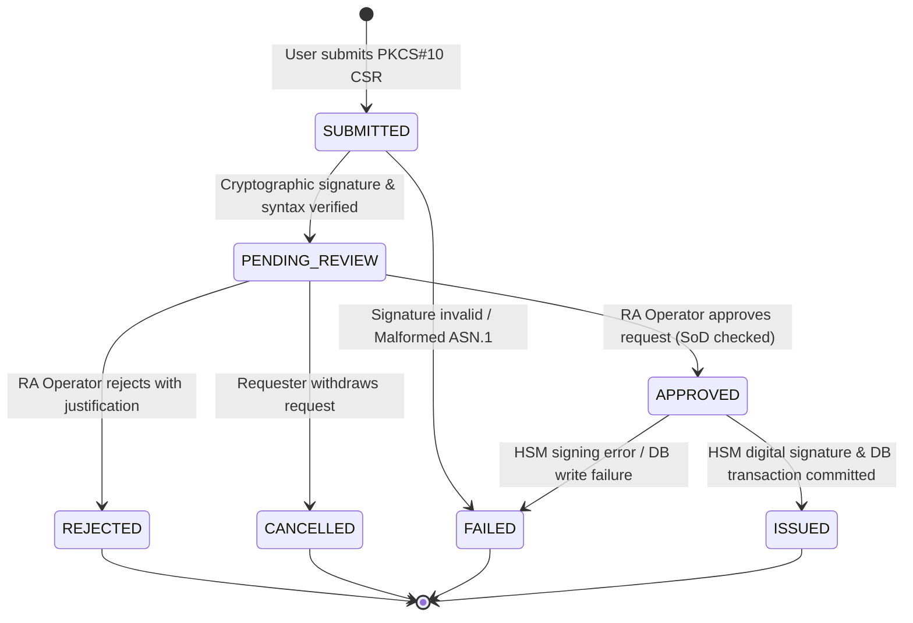
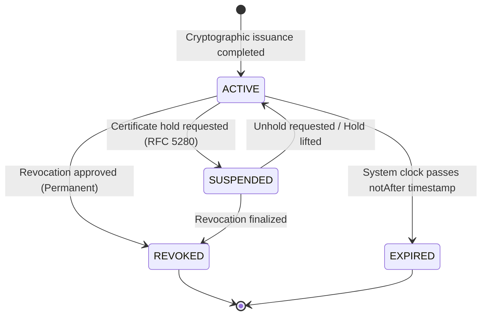
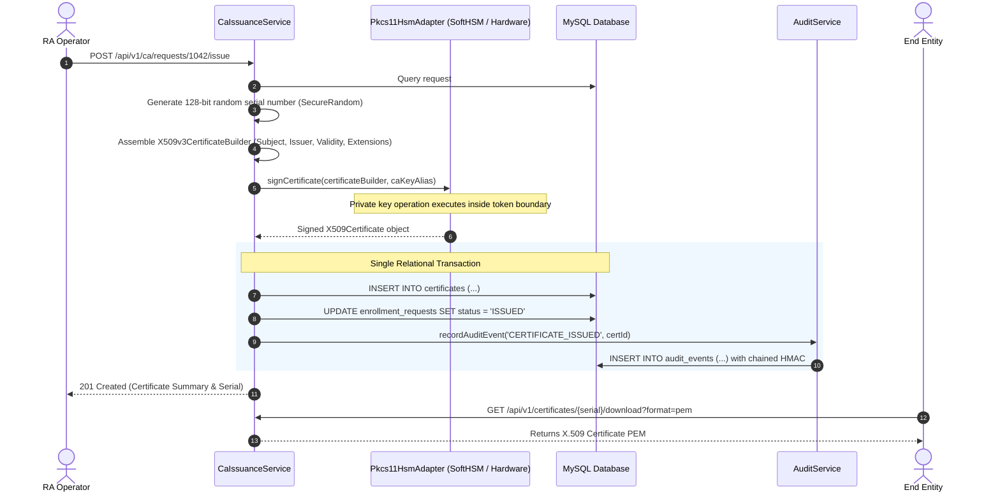
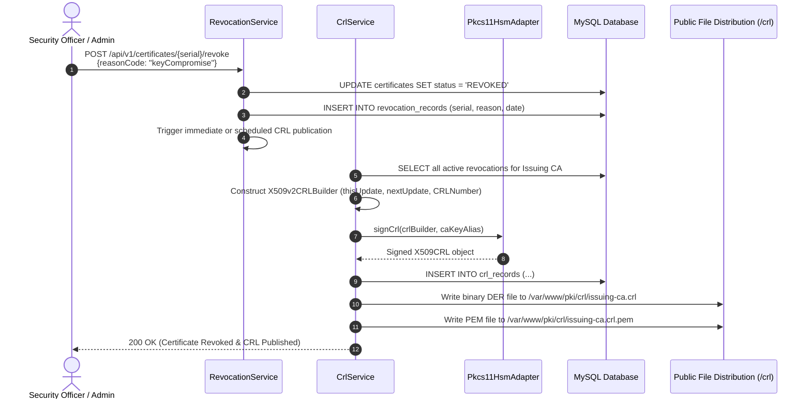

# Workflows, State Machines, and Transaction Boundaries
## PKI Issuing Certificate Authority System

- **Document ID:** DOC-WORK-008
- **Phase:** Phase 1 — Requirements Analysis, System Design, Architecture, and Development Planning
- **Status:** Approved / Workflow Baseline
- **Version:** 1.0.0
- **Classification:** Engineering Specification

---

## 1. Domain Finite State Machines (FSM)

### 1.1 Enrollment Request State Machine

#### State Transition Rules: `EnrollmentRequest`
| From State | To State | Trigger / Action | Authorization | Invariants & Side Effects |
| :--- | :--- | :--- | :--- | :--- |
| `[Initial]` | `SUBMITTED` | `POST /api/v1/enrollment/requests` | `END_ENTITY`, `RA_OPERATOR`, `CA_ADMIN` | Generates unique `request_id`, records timestamp, parses CSR attributes. |
| `SUBMITTED` | `PENDING_REVIEW` | System auto-validation passes | System | Proof-of-possession signature valid, key length within profile limits. |
| `SUBMITTED` | `FAILED` | System auto-validation fails | System | Emits audit event `ENROLLMENT_VALIDATION_FAILED`. No human review required. |
| `PENDING_REVIEW` | `APPROVED` | `POST /api/v1/ra/requests/{id}/approve` | `ROLE_RA_OPERATOR`, `ROLE_CA_ADMIN` | Enforces Separation of Duties: `requester_id != current_user_id`. Appends approval record. |
| `PENDING_REVIEW` | `REJECTED` | `POST /api/v1/ra/requests/{id}/reject` | `ROLE_RA_OPERATOR`, `ROLE_CA_ADMIN` | Mandatory comment required. Requester notified. State immutable. |
| `PENDING_REVIEW` | `CANCELLED` | Requester cancels | Request Owner | Allowed only while still pending. |
| `APPROVED` | `ISSUED` | HSM signing succeeds | System / Trigger | Certificate record created in MySQL. Audit event `CERTIFICATE_ISSUED`. |
| `APPROVED` | `FAILED` | HSM signing fails | System | Request reverts or marks `FAILED`. Alert emitted to Security Officer. |

---

### 1.2 Certificate Lifecycle State Machine

> **IMPORTANT PKI DISTINCTION:**  
> A certificate's status in the database (e.g. `EXPIRED` or `REVOKED`) is an operational tracking convenience. In RFC 5280, a relying party's trust decision is **computed independently at verification time** by comparing current time against `notAfter` and querying current CRLs/OCSP. Even if an expired certificate record has not been updated by an internal database cron, any compliant verifier will independently evaluate it as expired.

#### State Transition Rules: `Certificate`
| From State | To State | Trigger / Action | Authorization | Invariants & Side Effects |
| :--- | :--- | :--- | :--- | :--- |
| `[Initial]` | `ACTIVE` | Certificate issued by CA | Internal Issuance Engine | Random 128-bit serial allocated. Record immutable. Added to active index. |
| `ACTIVE` | `REVOKED` | Revocation request processed | Owner (if self), `RA_OPERATOR`, `SECURITY_OFFICER`, `CA_ADMIN` | `revocation_date` recorded with RFC 5280 reason. Flagged for next CRL. |
| `ACTIVE` | `SUSPENDED` | Revocation with reason `certificateHold` | `RA_OPERATOR`, `SECURITY_OFFICER` | Serial published on CRL with hold reason. Can be returned to `ACTIVE`. |
| `SUSPENDED` | `ACTIVE` | Reason code `removeFromCRL` applied | `SECURITY_OFFICER`, `CA_ADMIN` | Unhold audit logged; serial removed from subsequent CRLs. |
| `ACTIVE` | `EXPIRED` | Scheduled expiry sweep job | System Scheduler (`SYSTEM_SCHEDULER`) | Informational status update. |

---

## 2. End-to-End Workflow Specifications

### 2.1 Workflow 1: Authentication & Authorization Flow
1. **User Request:** Client submits username and password via `POST /api/v1/auth/login`.
2. **Rate Limiting:** `RateLimitingFilter` checks client IP against token bucket (limit: 5 attempts/minute).
3. **Credential Check:** `DaoAuthenticationProvider` queries `users` table and evaluates BCrypt hash.
4. **Account State:** If failed, increment `failed_attempts`. If >= 5, set `locked_until = now() + 30 min`. Emit audit event `AUTH_LOGIN_LOCKED`.
5. **Token Generation:** On success, generate HMAC-SHA256 JWT access token (15-min expiration) and random refresh token (stored in `user_tokens`).
6. **Response:** Return tokens, user metadata, and assigned roles.

---

### 2.2 Workflow 2 & 3: CSR Submission & Automated Verification Flow
1. **Key Generation:** Client generates asymmetric key pair locally (e.g., using `openssl req` or local keystore).
2. **Submission:** Authenticated End Entity submits `POST /api/v1/enrollment/requests` with PEM-encoded CSR and requested `profileCode`.
3. **ASN.1 Parsing:** Bouncy Castle `PKCS10CertificationRequest` parses the payload.
4. **Signature Verification (Proof-of-Possession):** 
   - Extract `SubjectPublicKeyInfo`.
   - Verify applicant's signature across `CertificationRequestInfo` using applicant's public key.
   - If invalid, reject immediately with `400 Bad Request` (`PKI-40012`).
5. **Policy Conformance:**
   - Verify public key algorithm and bit size match profile requirements.
   - Verify requested Subject DN and SANs conform to profile rules (e.g. wildcards rejected if `allowWildcards=false`).
6. **Persistence:** Insert row into `enrollment_requests` with status `PENDING_REVIEW` in a single ACID transaction. Dispatch `ENROLLMENT_SUBMITTED` audit event.

---

### 2.3 Workflow 4: RA Review, Approval, and Rejection
1. **Queue Inspection:** RA Operator navigates to Pending Requests dashboard (`GET /api/v1/enrollment/requests?status=PENDING_REVIEW`).
2. **Inspection:** RA Operator selects request #1042, inspecting subject identity, SANs, and key fingerprint.
3. **Separation of Duties Check:** System verifies `request.requester_id != authenticated_user.id`. If equal, UI disables approval button and API returns `403 Forbidden` (`PKI-40301: Self-approval prohibited`).
4. **Decision Execution:**
   - **If Approved:** Operator enters review comment. System updates status to `APPROVED`, records review timestamp in `request_approvals`, and triggers issuance.
   - **If Rejected:** Operator enters mandatory rejection code and explanation. Status updates to `REJECTED`. Requester receives notification.

---

### 2.4 Workflow 5: Certificate Issuance & Packaging

---

### 2.5 Workflow 6: Certificate Renewal
1. **Renewal Eligibility:** Active certificates nearing expiration (e.g., within 30 days) can be renewed via `POST /api/v1/certificates/{serial}/renew`.
2. **Options:**
   - **Existing Key:** Reuse existing public key (subject to organizational policy).
   - **New Key (Recommended):** Provide a new CSR with a newly generated key pair.
3. **Workflow Linkage:** System generates a new `EnrollmentRequest` flagged with `prior_certificate_id`, inheriting approved attributes while validating validity limits.
4. **Approval & Issuance:** Passes through standard RA review or streamlined renewal policy, producing a new certificate with a distinct serial number.

---

### 2.6 Workflow 7: Revocation & CRL Publication

---

### 2.7 Workflow 8: Certificate Validation Engine
1. **Client Invocation:** Client submits candidate certificate PEM to `POST /api/v1/validation/verify-cert`.
2. **Step 1 — Format & Parse:** Verify valid X.509 v3 encoding.
3. **Step 2 — Cryptographic Signature:** Verify signature using the public key of the Issuing CA. If mismatch, return `INVALID_SIGNATURE`.
4. **Step 3 — Validity Window:** Check current system timestamp against `notBefore` and `notAfter`. If out of bounds, return `EXPIRED` or `NOT_YET_VALID`.
5. **Step 4 — Basic Constraints & Usage:** Verify `isCA=false` for end entity and critical extension conformance.
6. **Step 5 — Revocation Evaluation:** Query `revocation_records` by serial number. If present, return `REVOKED` with exact timestamp and reason code.
7. **Result:** Return comprehensive validation JSON payload.

---

### 2.8 Workflow 9: RFC 6960 OCSP Responder Transaction
1. **Client Request:** Relying party client submits binary OCSP request via `POST /api/v1/ocsp` (`Content-Type: application/ocsp-request`).
2. **Parsing:** Bouncy Castle `OCSPReq` parses the ASN.1 request structure and extracts target certificate `CertID` (hash of issuer name, issuer key, and target serial number).
3. **Issuer Verification:** Verify issuer hash matches Issuing CA. If unrecognized, return `successful` response with status `unknown`.
4. **Status Evaluation:**
   - Lookup `serial_number` in `certificates` and `revocation_records`.
   - If not in database -> return `unknown`.
   - If in `revocation_records` -> return `revoked` with revocation time and reason.
   - If active in `certificates` -> return `good`.
5. **Signing:** Construct `BasicOCSPRespBuilder`, set `thisUpdate = now()`, `nextUpdate = now() + 24 hours`, and sign using HSM-backed CA key or dedicated OCSP signing key.
6. **Response:** Return HTTP 200 with `Content-Type: application/ocsp-response`.

---

### 2.9 Workflow 10: Administrative Configuration & Audit Review
1. **Config Update:** CA Administrator updates global configuration parameter via `PUT /api/v1/admin/config`.
2. **Audit Logging:** System writes old and new values to `audit_events` with chained HMAC.
3. **Auditor Inspection:** Auditor logs in (`ROLE_AUDITOR`) and navigates to Audit Trail.
4. **Integrity Verification:** Auditor clicks "Verify Log Chain". System recalculates HMAC sequence `H_i = HMAC(H_{i-1} + record_i)` from row 1 to current. If any record was altered out-of-band via raw SQL, verification flags the corrupted sequence ID immediately.

---

### 2.10 Workflow 11: HSM Failure Handling & Circuit Breaking
1. **Failure Trigger:** HSM token communication drops (`CKR_DEVICE_REMOVED` or timeout).
2. **Catch & Isolate:** `Pkcs11HsmAdapter` catches `PKCS11Exception`.
3. **Circuit Breaker:** State switches to `OPEN`. CA operational status marked `DEGRADED`.
4. **Safe Failure:** Active certificate signing aborts cleanly. Database transaction rolls back; no orphan certificate or invalid audit entry is committed.
5. **Retry / Reconnection:** Background heartbeat task executes every 30 seconds attempting session re-authentication. When HSM responds, circuit resets to `CLOSED`.

---

### 2.11 Workflow 12: Database Backup & Recovery Procedure
1. **Backup Trigger:** Cron schedule or CA Administrator triggers `POST /api/v1/admin/backups/create`.
2. **Execution:** Database transaction locks or consistent snapshot (`mysqldump --single-transaction`) executes, outputting encrypted `.sql.gz` dump.
3. **Checksum:** SHA-256 hash computed and recorded in `backup_records`.
4. **Disaster Recovery:** In event of host destruction:
   - Restore MySQL dump to fresh server.
   - Connect HSM token (or restore SoftHSM token directory from encrypted backup volume).
   - Re-verify audit hash chain. CA resumes active status.
