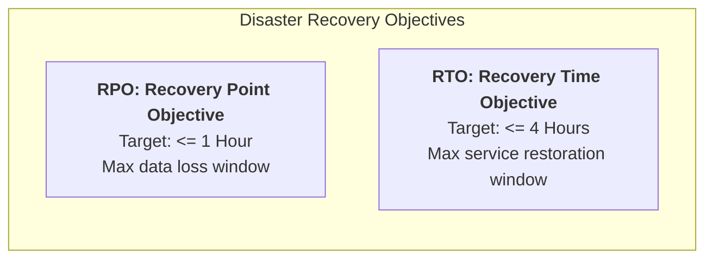

# Non-Functional Requirements & Performance Targets
## PKI Issuing Certificate Authority System

- **Document ID:** DOC-NFR-010
- **Phase:** Phase 1 — Requirements Analysis, System Design, Architecture, and Development Planning
- **Status:** Approved / Architecture Baseline
- **Version:** 1.0.0
- **Classification:** Engineering Specification

---

## 1. Quantitative Performance & Capacity Targets

All performance targets are calibrated against defined test hardware and workload assumptions. Targets marked `[Dev/SoftHSM]` apply to the development environment; targets marked `[Prod/Hardware HSM]` designate production requirements.

| Metric ID | Description | Target Value | Baseline Assumptions | Verification Method |
| :--- | :--- | :--- | :--- | :--- |
| **NFR-PERF-01** | **Certificate Issuance Throughput** | >= 10 certs/sec `[Dev]` >= 50 certs/sec `[Prod]` | 4-core CPU, 8GB RAM, SoftHSM2 file token (Dev) vs PCIe Hardware HSM (Prod). | Automated load test (`k6` / JMeter) issuing sequential approved requests. |
| **NFR-PERF-02** | **Validation API Latency** | <= 50 ms (p95) <= 100 ms (p99) | Path validation endpoint `/api/v1/validation/verify-cert` under 100 concurrent requests. | HTTP benchmark client measuring server round-trip latency. |
| **NFR-PERF-03** | **OCSP Responder Latency** | <= 25 ms (p95) <= 50 ms (p99) | Binary OCSP queries (`POST /api/v1/ocsp`) under sustained load of 500 req/sec. | Locust / k6 load harness hitting warm in-memory cached serial indexes. |
| **NFR-PERF-04** | **General REST API Latency** | <= 100 ms (p95) | Standard CRUD endpoints (list requests, view cert, login) with 50 concurrent users. | Spring Boot Actuator timer metrics & browser synthetic tests. |
| **NFR-PERF-05** | **CRL Generation Time** | <= 10 seconds | Revocation list containing up to 100,000 active revoked serial entries. | Benchmarking `CrlService.generateCrl()` execution time with 100k DB entries. |
| **NFR-PERF-06** | **CSR Ingestion & Parse Time** | <= 20 ms (p95) | ASN.1 decoding and proof-of-possession signature verification on RSA-2048/EC-P256 CSRs. | Micro-benchmarks using JMH (Java Microbenchmark Harness). |
| **NFR-PERF-07** | **Database Capacity** | >= 1,000,000 certificates | Storage and indexing without degradation of serial lookup query times (< 2 ms). | Synthetic database population of 1M rows with B-Tree index benchmarks. |

---

## 2. High Availability & Reliability

| Metric ID | Dimension | Target Specification | Design Implementation |
| :--- | :--- | :--- | :--- |
| **NFR-AVAIL-01** | **Issuing CA Uptime** | 99.9% availability during business hours (< 8.76 hours downtime/year). | Containerized deployment with automated Docker health checks and restart policies. |
| **NFR-AVAIL-02** | **Validation & OCSP Uptime** | 99.99% availability (24x7x365). | Stateless validation endpoints capable of horizontal replica scaling behind load balancer. |
| **NFR-REL-01** | **Transaction Atomicity** | 100% ACID compliance on issuance and revocation. | Spring `@Transactional` wrapping database writes and audit log append. Zero orphan certs on HSM failure. |
| **NFR-REL-02** | **Idempotency** | Zero duplicate issuance on retry. | Unique constraint on `request_id` in `certificates` table; client-supplied `Idempotency-Key` header on issuance requests. |
| **NFR-REL-03** | **HSM Circuit Breaker** | Circuit opens after 3 consecutive HSM errors; resets after successful heartbeat. | Resilience4j circuit breaker isolating PKCS#11 JNI calls; prevents thread pool starvation. |

---

## 3. Security & Compliance Metrics

| Metric ID | Security Attribute | Requirement Target | Verification Protocol |
| :--- | :--- | :--- | :--- |
| **NFR-SEC-01** | **Key Protection Invariant** | 0 bits of CA private key in memory dumps, logs, or databases. | Heap dump inspection after 1,000 signing operations; static code analysis; DB text scans. |
| **NFR-SEC-02** | **Serial Number Entropy** | At least 64 bits of CSPRNG entropy per serial. | Statistical randomness testing (NIST SP 800-22 test suite on 10,000 generated serials). |
| **NFR-SEC-03** | **Password Encryption** | BCrypt work factor >= 12 (computational time ~250ms per hash). | Unit test validating password encoder configuration and hash execution time. |
| **NFR-SEC-04** | **Audit Trail Integrity** | 100% tamper detection across any modified or omitted record. | Automated unit/integration test altering a row directly in MySQL; verify chain failure. |
| **NFR-SEC-05** | **Authentication Security** | 5 consecutive failed attempts lock account for 30 minutes. | Automated Playwright / API integration test simulating brute-force attempt. |

---

## 4. Usability & User Experience

| Metric ID | Usability Attribute | Target Target | Measurement Method |
| :--- | :--- | :--- | :--- |
| **NFR-USE-01** | **Frontend Initial Load Time** | < 1.5 seconds on broadband connections (LCP < 2.0s). | Google Lighthouse performance audit on Vite production bundle. |
| **NFR-USE-02** | **UI Interaction Responsiveness** | < 100 ms feedback on button clicks and modal dialogs. | Chrome DevTools user timing marks and micro-animations. |
| **NFR-USE-03** | **Accessibility Conformance** | WCAG 2.1 Level AA compliance across all forms and tables. | Automated axe-core accessibility scanner integrated into Playwright test suite. |
| **NFR-USE-04** | **Error Clarity** | 100% of API errors return user-friendly, actionable RFC 7807 messages. | Integration test verifying all exception handlers populate `detail` and `invalidParams`. |

---

## 5. Maintainability & Code Quality

| Metric ID | Dimension | Metric Target | Tooling & Enforcement |
| :--- | :--- | :--- | :--- |
| **NFR-MAINT-01**| **Automated Test Coverage** | >= 80% line coverage on domain, service, and security layers. | JaCoCo code coverage plugin in Maven build pipeline. |
| **NFR-MAINT-02**| **Code Modularity** | Clean layer separation; zero circular package dependencies. | ArchUnit architectural fitness tests enforcing package boundary rules. |
| **NFR-MAINT-03**| **Schema Evolution** | 100% repeatable, version-controlled database migrations. | Flyway migration scripts (`V1__...`, `V2__...`) tested on clean DB startup. |
| **NFR-MAINT-04**| **API Documentation** | 100% of endpoints documented with request/response schemas. | SpringDoc OpenAPI 3.0 generating interactive Swagger UI at `/swagger-ui.html`. |

---

## 6. Observability & Telemetry

| Metric ID | Telemetry Component | Target Implementation | Ingestion Target |
| :--- | :--- | :--- | :--- |
| **NFR-OBS-01** | **Structured Logging** | JSON-formatted application logs with MDC tracing (`traceId`, `spanId`, `userId`, `clientIp`). | Logback with Logstash JSON encoder targeting stdout / flat file. |
| **NFR-OBS-02** | **Application Metrics** | Standard Prometheus metrics at `/actuator/prometheus`. | Key gauges: active certificates, pending RA requests, HSM latency, JVM memory. |
| **NFR-OBS-03** | **Health Probes** | Spring Boot Actuator liveness and readiness probes (`/actuator/health`). | Validates DB connection pool status, disk storage space, and PKCS#11 slot communication. |

---

## 7. Disaster Recovery & Continuity (RPO / RTO)

- **Recovery Point Objective (RPO):** **<= 1 hour**. Database transactional logs and binlogs are backed up continuously or hourly. In the worst-case database loss scenario, no more than 1 hour of certificate issuance records or audit logs are lost.
- **Recovery Time Objective (RTO):** **<= 4 hours**. From the moment of total server failure, automated deployment scripts, container initialization, database restore, and HSM token attachment must return the CA to fully active operational status within 4 hours.
