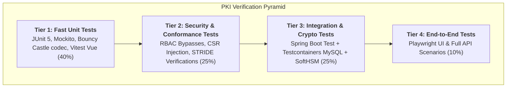

# Acceptance Criteria & Comprehensive Test Strategy
## PKI Issuing Certificate Authority System

- **Document ID:** DOC-TEST-011
- **Phase:** Phase 1 — Requirements Analysis, System Design, Architecture, and Development Planning
- **Status:** Approved / Quality Baseline
- **Version:** 1.0.0
- **Classification:** Engineering Specification

---

## 1. Traceable Acceptance Criteria (AC)

The system's functional readiness and security posture are governed by explicit, testable Acceptance Criteria:

### 1.1 CA Initialization & Key Governance
- **AC-001 (CA Token Initialization):** When a CA Administrator invokes `POST /api/v1/ca/init` with valid parameters, an asymmetric key pair (RSA-4096 or ECDSA-P384) is generated within the HSM token with `CKA_EXTRACTABLE=false`, a PKCS#10 CSR is returned, and status is set to `INITIALIZING`.
- **AC-002 (Intermediate CA Certificate Import):** When a CA Administrator imports a valid parent-signed certificate chain via `POST /api/v1/ca/import-cert`, the system verifies signature continuity and transitions CA status to `ACTIVE`.

### 1.2 Identity Enrollment & CSR Validation
- **AC-003 (Proof-of-Possession Validation):** When a valid PKCS#10 CSR is submitted, the system verifies the digital signature across `CertificationRequestInfo` using the embedded public key; if signature verification fails, the request is rejected immediately with HTTP 400.
- **AC-004 (Key Strength Policy Rejection):** When an applicant submits a CSR with an RSA key length < 2048 bits or an unauthorized curve, the system returns HTTP 400 with error code `PKI-40013` (Weak Key Rejected).
- **AC-005 (Subject DN & SAN Extraction):** When a valid CSR with multiple DNS and IP SANs is submitted, all SANs are parsed, stored in JSON format, and linked to the authenticated user ID.

### 1.3 RA Review & Separation of Duties
- **AC-006 (Human RA Approval):** When an RA Operator approves an enrollment request, the status transitions to `APPROVED`, an immutable review record is created, and the reviewer's ID, comment, and client IP are logged.
- **AC-007 (Self-Approval Prohibition):** When an RA Operator attempts to approve an enrollment request that they submitted under their own username, the API returns HTTP 403 Forbidden with error code `PKI-40301`.
- **AC-008 (Mandatory Rejection Justification):** When an RA Operator rejects a request without supplying a rejection reason, the request is blocked by Bean Validation (HTTP 400). When supplied, status transitions to `REJECTED`.

### 1.4 Cryptographic Issuance & Profile Enforcement
- **AC-009 (HSM Certificate Issuance):** When an approved request is signed, the system invokes SoftHSM via SunPKCS11, constructs an RFC 5280 X.509 v3 certificate, and persists it to MySQL within a single atomic database transaction.
- **AC-010 (Serial Number Entropy):** Every issued certificate possesses a positive serial number containing at least 64 bits of CSPRNG entropy; sequential or predictable serial numbers are rejected by policy.
- **AC-011 (Profile Extension Integrity):** Issued certificates strictly match the assigned profile (e.g. `TLS_SERVER` enforces `BasicConstraints(cA=false)`, `KeyUsage(digitalSignature, keyEncipherment)`, and `EKU(serverAuth)`).

### 1.5 Certificate Retrieval & Download
- **AC-012 (Multi-Format Download):** When an authorized user requests certificate download, the system returns valid PEM, DER binary, and PKCS#7 (`.p7b`) complete chain bundles matching RFC standards.
- **AC-013 (Resource Ownership Boundary):** When an End Entity attempts to download an unapproved private certificate or view another entity's request details, the query returns HTTP 404 / 403.

### 1.6 Renewal & Revocation
- **AC-014 (Certificate Renewal Workflow):** When an active certificate owner submits a renewal request, a new enrollment request is generated, preserving verified identity while permitting a new CSR key pair.
- **AC-015 (Immediate Revocation Execution):** When an authorized user or security officer submits a revocation request with an RFC 5280 reason code, the certificate status transitions to `REVOKED` immediately, recording the timestamp.
- **AC-016 (Revoked Key Re-enrollment Block):** When a CSR is submitted containing a public key previously revoked with reason `keyCompromise`, the enrollment engine permanently rejects the request.

### 1.7 CRL Generation & Validation Services
- **AC-017 (RFC 5280 CRL Format):** Published CRLs are valid X.509 v2 CRLs signed by the CA key in the HSM, containing serial numbers, revocation dates, and reason codes for all currently revoked certificates.
- **AC-018 (Automated Scheduled CRL Publication):** The system automatically regenerates and overwrites published CRL files before the `nextUpdate` window expires.
- **AC-019 (Independent Path Validation):** When a certificate PEM is submitted to `/api/v1/validation/verify-cert`, the engine accurately evaluates signature validity, expiration window, and revocation status, returning `VALID`, `REVOKED`, or `EXPIRED`.
- **AC-020 (RFC 6960 OCSP Responder):** The OCSP responder processes standard binary `application/ocsp-request` payloads and returns signed `application/ocsp-response` structures accurately indicating `good`, `revoked`, or `unknown`.

### 1.8 Audit Trail & Security Defense
- **AC-021 (Tamper-Evident Chaining):** Every security-relevant event produces an audit record with `HMAC-SHA256(prevHash + payload, secret)`. Modifying any database row causes chain verification to fail at that row index.
- **AC-022 (Audit Immutability):** Standard application database user lacks `UPDATE` and `DELETE` grants on `audit_events`.
- **AC-023 (Account Lockout Enforcement):** Five consecutive failed login attempts lock the user account for 30 minutes, rejecting subsequent login attempts with HTTP 423 Locked.
- **AC-024 (Zero Key Leakage Verification):** CA private key bytes are absent from all database tables, heap dumps, application logs, and API JSON responses.

### 1.9 Disaster Recovery
- **AC-025 (Backup & Restore Verifiability):** Database backup dumps restore successfully to a clean MySQL instance, passing data integrity and audit chain checks.

---

## 2. Multi-Tier Testing Pyramid

The verification strategy implements a disciplined multi-tier test pyramid:

---

## 3. Test Tier Specifications

### 3.1 Tier 1: Unit Testing
- **Frameworks:** JUnit 5, Mockito, AssertJ, Vitest (Vue 3 frontend).
- **Execution Speed:** < 30 seconds for entire suite.
- **Target Line Coverage:** >= 80% on domain services, policy engines, and controllers.
- **Scope:**
  - ASN.1 CSR decoding, parsing, and proof-of-possession signature verification.
  - X.509 serial number generation randomness and entropy checks.
  - Certificate profile constraint evaluation (key usages, EKUs, validity limits).
  - RFC 7807 error response serialization.
  - Pinia authentication store state transitions and Vue router navigation guards.

### 3.2 Tier 2: Security & Conformance Testing
- **Scope:**
  - **Separation of Duties Verification:** Automated tests asserting that RA Operators cannot approve self-submitted requests.
  - **CSR Injection Attacks:** Submitting crafted CSRs with malformed ASN.1, embedded `cA=true` basic constraints, weak 512-bit RSA keys, and unauthorized SAN wildcards.
  - **RBAC Matrix Enforcement:** Iterating all REST endpoints across all five roles to ensure unauthorized roles receive HTTP 403 Forbidden.
  - **Audit Hash-Chain Tamper Detection:** Intentionally mutating row data in the database and verifying that `AuditVerificationService` flags corruption.
  - **Brute Force Protection:** Testing rate limiting filters and account lockout thresholds.

### 3.3 Tier 3: Integration & Cryptographic Testing
- **Frameworks:** Spring Boot Test (`@SpringBootTest`), Testcontainers for MySQL 8, SoftHSM2 test fixture container.
- **Scope:**
  - End-to-end enrollment request persistence and transaction rollback testing.
  - PKCS#11 SunPKCS11 provider interaction with SoftHSM2 token slot 0.
  - Key pair generation in token and certificate signing via opaque key handles.
  - Scheduled CRL publication task writing physical DER and PEM files to disk.
  - Binary OCSP request/response decoding and cryptographic signature verification.
  - Database schema migration validation via clean Flyway execution.

### 3.4 Tier 4: End-to-End (E2E) Browser & API Testing
- **Framework:** Playwright (Chromium / Firefox / WebKit).
- **Scope:**
  - Complete user lifecycle: Login as End Entity -> Submit CSR -> Logout.
  - Login as RA Operator -> Inspect queue -> Approve request -> Verify status.
  - Login as End Entity -> Download issued certificate PEM.
  - Submit renewal and revocation requests.
  - Login as Auditor -> Inspect audit log -> Run cryptographic chain verification.
  - Verify responsive UI layout, dark/light theme toggle, and accessibility standards.

---

## 4. Test Identification & Requirements Mapping Matrix

| Test ID | Test Category | Target Component | Verifies Requirement | Verifies AC |
| :--- | :--- | :--- | :--- | :--- |
| `TEST-UNIT-001` | Unit (Bouncy Castle) | `CsrParserService` | `FR-011`, `CR-014` | `AC-003` |
| `TEST-UNIT-002` | Unit (Policy Engine) | `CertificateProfileService` | `FR-040`, `CR-007` | `AC-011` |
| `TEST-UNIT-003` | Unit (Crypto Random) | `SerialNumberGenerator` | `CR-005` | `AC-010` |
| `TEST-SEC-001` | Security (CSR Inject) | `EnrollmentController` | `SR-013`, `FR-013` | `AC-004` |
| `TEST-SEC-002` | Security (SoD Bypass) | `RaApprovalService` | `SR-006`, `FR-022` | `AC-007` |
| `TEST-SEC-003` | Security (Key Leak) | Heap / DB / Logs | `SR-010`, `HR-002` | `AC-024` |
| `TEST-SEC-004` | Security (Audit Chain)| `AuditService` | `SR-005`, `ALR-003` | `AC-021` |
| `TEST-SEC-005` | Security (Lockout) | `AuthenticationService` | `SR-004` | `AC-023` |
| `TEST-INT-001` | Integration (HSM) | `Pkcs11HsmAdapter` | `FR-070`, `HR-001` | `AC-001`, `AC-009` |
| `TEST-INT-002` | Integration (DB/JPA) | `CaIssuanceService` | `FR-030`, `NFR-REL-01` | `AC-009` |
| `TEST-INT-003` | Integration (CRL) | `CrlService` | `FR-060`, `VR-002` | `AC-017`, `AC-018` |
| `TEST-INT-004` | Integration (OCSP) | `OcspResponderService` | `FR-065`, `CR-008` | `AC-020` |
| `TEST-E2E-001` | E2E (Full Lifecycle) | Vue 3 UI + REST API | `FR-010`–`FR-035` | `AC-006`, `AC-009`, `AC-012` |
| `TEST-E2E-002` | E2E (Revocation) | Vue 3 UI + REST API | `FR-034`, `FR-062` | `AC-015`, `AC-017` |
| `TEST-E2E-003` | E2E (Auditor View) | Vue 3 UI + REST API | `FR-100`, `ALR-002` | `AC-021` |
| `TEST-DR-001` | Disaster Recovery | Backup/Restore Script | `FR-110`, `BDR-001` | `AC-025` |

---

## 5. Automated CI/CD Quality Gates

For subsequent development phases, automated CI pipelines (GitHub Actions / GitLab CI) must enforce the following passing gates:
1. **Compilation & Formatting:** Clean build without warnings (`mvn clean compile`, `npm run build`).
2. **Unit & Security Tests:** 100% test pass rate (`mvn test`, `npm run test:unit`).
3. **Static Analysis & Dependencies:** Zero high/critical CVEs (`mvn dependency-check:check`, SonarQube quality gate).
4. **Integration Tests with Testcontainers:** 100% pass rate using containerized SoftHSM2 and MySQL (`mvn verify -Pintegration`).
5. **Code Coverage:** JaCoCo overall line coverage >= 80%.
