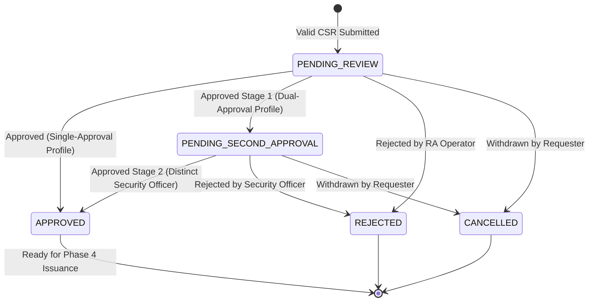

# Phase 3 Implementation Report — Registration Authority (RA) Workflow & Policy Enforcement

- **System:** PKI Issuing Certificate Authority System
- **Phase:** Phase 3 — Registration Authority (RA) Request Workflow, CSR Proof-of-Possession, Profile Policy Enforcement, Review Queue & Separation of Duties
- **Date:** October 20, 2026
- **Status:** **COMPLETE & VERIFIED**
- **Test Suite Results:**
  - **Backend:** **56 / 56 tests passed (100%)** on Java 21 LTS + H2 + MySQL 8.0.36
  - **Frontend:** **18 / 18 tests passed (100%)** on Vitest + TypeScript + Vue 3
  - **Production Builds:** Both Maven backend JAR and Vite frontend bundle compiled with 0 errors.

---

## 1. Executive Summary & Objective

In Phase 3, the PKI Issuing Certificate Authority System achieved full implementation of the **Registration Authority (RA) enrollment request and approval lifecycle**. This subsystem serves as the mandatory gatekeeper between end-entity applicants and CA cryptographic signing operations.

### Scope Boundaries Enforced
- **Implemented:** End-entity PKCS#10 CSR submission, Bouncy Castle cryptographic Proof-of-Possession (PoP) signature verification, Certificate Profile policy enforcement, duplicate/idempotency protection, RA review queue, approval state machine transitions, separation of duties (Rule SoD-01 & Rule SoD-03), and structured security audit logging.
- **Strictly Excluded (In Scope for Phase 4+):** Cryptographic certificate signing, HSM/SoftHSM private key operations, CRL issuance, and OCSP responders. No CA signing keys were generated or exercised.

---

## 2. Architecture & Data Model

### 2.1 Flyway Migration: `V3__init_enrollment_schema.sql`
The database schema was extended with three dedicated tables and four baseline certificate policy profiles:

1. **`certificate_profiles`**:
   - Stores policy rules governing key types, maximum validity duration, required SANs, wildcard prohibition, and dual-approval flags.
   - Seeded profiles:
     - `TLS_SERVER`: Internal TLS Server Certificate (RSA-2048 to 4096, ECDSA-P256/P384, max 730 days, mandatory SAN, no wildcards, single approval).
     - `TLS_CLIENT`: Internal TLS Client Certificate (RSA-2048 to 3072, ECDSA-P256, max 730 days, single approval).
     - `CODE_SIGNING`: Enterprise Code Signing Certificate (RSA-3072 to 4096, ECDSA-P384, max 365 days, **requires dual approval**).
     - `DEVICE_IDENTITY`: 802.1X Device Identity Certificate (RSA-2048, ECDSA-P256, max 1095 days).
2. **`enrollment_requests`**:
   - Foreign keys to `users(id)` and `certificate_profiles(id)`.
   - Stores Subject DN, parsed SAN entries (JSON text array), raw CSR PEM, public key algorithm, key length, public key SHA-256 fingerprint, validity duration, rejection reason, status, and optimistic locking version.
   - Indexes on `requester_id`, `status`, `public_key_fingerprint`, and `created_at`.
3. **`request_approvals`**:
   - Tracks immutable review history with foreign keys to `enrollment_requests(id)` and `users(id)`.
   - Records `action` (`APPROVED`, `REJECTED`), `review_stage` (`INITIAL_REVIEW`, `SECOND_APPROVAL`), reviewer comments, client IP, and timestamp.

---

## 3. Cryptographic CSR Verification & Policy Enforcement

### 3.1 CSR Parser Service (`CsrParserService.java`)
- **ASN.1 / PKCS#10 Parsing:** Leverages Bouncy Castle `PKCS10CertificationRequest` and `PEMParser`.
- **Proof-of-Possession (PoP) Verification:** Computes verification of the CSR signature over `CertificationRequestInfo` using applicant's embedded public key via `JcaContentVerifierProviderBuilder`. Malformed signatures or spoofed keys immediately reject with `400 Bad Request` (`PKI-40012`).
- **DoS Protection & Sanitization:** Enforces 16KB max payload limit on PEM inputs. Rejects malformed base64, null, or non-CSR PEM headers with `PKI-40011`.
- **Public Key & Fingerprint Extraction:** Computes SHA-256 digest of `SubjectPublicKeyInfo` DER bytes to generate an immutable 64-character lowercase hexadecimal fingerprint.
- **SAN Parsing:** Extracts extension request attributes (`pkcs_9_at_extensionRequest`), parsing `GeneralNames` into DNS, IP, EMAIL, and URI components.

### 3.2 Profile Policy Validation (`ProfileValidationService.java`)
- **Key Spec Conformance:** Verifies public key algorithm and bit size against the profile's allowed list (e.g. RSA-1024 is strictly rejected; RSA-2048 or ECDSA-P256 accepted).
- **Duration Clamping:** Rejects requests requesting validity days beyond `profile.maxValidityDays` (`PKI-40021`). Defaults to `defaultValidityDays` when omitted.
- **SAN Rules:** Enforces mandatory SAN presence when `requireSan = true` (`PKI-40023`).
- **Wildcard Prohibition:** Strictly rejects `*` in Subject DN or SAN entries when `allowWildcards = false` (`PKI-40024`).

---

## 4. State Machine & Separation of Duties (SoD)

### 4.1 Request State Machine


### 4.2 Separation of Duties Invariants
- **Rule SoD-01 (No Self-Approval):** The system prevents any user from approving their own request (`request.requesterId == currentUserId`). Throws `403 Forbidden` with `"Self-approval prohibited: Requester cannot approve their own enrollment request."` and logs an attributable security violation audit record.
- **Rule SoD-03 (Dual-Approval for High-Assurance):**
  - Profiles with `requiresDualApproval = true` (e.g. `CODE_SIGNING`) transition from `PENDING_REVIEW` to `PENDING_SECOND_APPROVAL` on Stage 1 review.
  - Stage 2 approval strictly requires `ROLE_SECURITY_OFFICER` or `ROLE_CA_ADMIN`.
  - The second approver must be an independent individual from the Stage 1 reviewer (`approval.reviewerId != currentUserId`). Any attempt by the same reviewer returns `400 Bad Request` (`PKI-40030`).
- **Ownership Fence:** End-entity applicants can only view, track, or cancel requests belonging to their user account (`requester_id = :userId`).

---

## 5. REST API Endpoints

| Method | Endpoint | Authorization | Description |
| :--- | :--- | :--- | :--- |
| `POST` | `/api/v1/enrollment/requests` | `END_ENTITY`, `RA_OPERATOR`, `CA_ADMIN` | Submits PKCS#10 CSR for verification and profile assignment. |
| `GET` | `/api/v1/enrollment/requests` | All Authenticated Roles | Returns queue for RA staff; returns user's own requests for End Entities. |
| `GET` | `/api/v1/enrollment/requests/{id}` | Owner, RA, Admin, Auditor | Retrieves detailed request metadata, parsed SANs, and approval trail. |
| `POST` | `/api/v1/enrollment/requests/{id}/cancel` | Owner, Admin | Cancels pending enrollment request. |
| `POST` | `/api/v1/ra/requests/{id}/approve` | `RA_OPERATOR`, `CA_ADMIN`, `SECURITY_OFFICER` | Approves request with SoD & dual-approval verification. |
| `POST` | `/api/v1/ra/requests/{id}/reject` | `RA_OPERATOR`, `CA_ADMIN` | Formally rejects request with mandatory justification. |
| `GET` | `/api/v1/profiles` | Authenticated | Lists all active certificate policy profiles. |
| `GET` | `/api/v1/profiles/{code}` | Authenticated | Retrieves specific profile constraints. |

---

## 6. Frontend Components

1. **`src/views/EnrollmentView.vue`**:
   - End-entity enrollment wizard with profile selector displaying real-time policy rules (allowed keys, max days, SAN rules).
   - Direct text input or `.csr`/`.pem` file upload.
   - Client-side format pre-validation and submission progress indicators.
   - "My Requests" history tab with live status badges, detail inspector modal, and cancellation actions.
2. **`src/views/RaQueueView.vue`**:
   - Human review interface for RA Operators, Security Officers, and Administrators.
   - Multi-status filter (`PENDING_REVIEW`, `PENDING_SECOND_APPROVAL`, `APPROVED`, `REJECTED`, `CANCELLED`).
   - Requester identification with clear visual badges for self-requests.
   - Comprehensive review modal with full CSR, public key fingerprint, SAN tags, and approval timeline.
   - Action controls with client-side and server-side SoD enforcement disabling self-approval.
   - Rejection dialog with mandatory reason selection code and explanatory comments.
3. **Navigation & Guard Integration**:
   - Added active routes in `src/router/index.ts` with role-based metadata.
   - Activated sidebar links in `src/components/AppSidebar.vue`.

---

## 7. Verification & Test Execution Summary

### Backend Test Results (Maven 3.9 / Surefire 3.2.5 / Java 21)
```
[INFO] Results:
[INFO] Tests run: 56, Failures: 0, Errors: 0, Skipped: 0
[INFO] BUILD SUCCESS
```

| Test Class | Tests Run | Result | Notes |
| :--- | :---: | :---: | :--- |
| `CsrParserServiceTest` | 6 | **PASS** | RSA/EC parsing, PoP verification, spoofed signature rejection, malformed PEM, size limits. |
| `ProfileValidationServiceTest` | 7 | **PASS** | Key spec filtering (RSA-1024 rejection), SAN requirements, wildcard prohibitions, validity bounds. |
| `EnrollmentWorkflowIntegrationTest` | 11 | **PASS** | End-to-end CSR submission, duplicate conflict (409), ownership fence, SoD-01 self-approval rejection, RA approval, rejection with reason, dual-approval workflow (Code Signing), request cancellation. |
| `FlywayMigrationAndSchemaTest` | 3 | **PASS** | Verifies V1, V2, and V3 migrations and seeding of all 5 roles and 4 profiles. |
| `MySqlMigrationAndPersistenceIntegrationTest` | 1 | **PASS** | Verified on live MySQL 8.0.36 Docker container (`pki-mysql-dev`). |
| `AuthenticationIntegrationTest` | 5 | **PASS** | Regressions check: Login, refresh, lockout, password validation. |
| `RbacAuthorizationIntegrationTest` | 5 | **PASS** | Regressions check: Role-based authorization across all endpoints. |
| `UserManagementIntegrationTest` | 4 | **PASS** | Regressions check: Provisioning, user lockout, demotion guards. |
| `AdminProtectionSecurityTest` | 3 | **PASS** | Regressions check: Sole administrator deletion and lockout guards. |
| `JwtTokenProviderTest` | 3 | **PASS** | Regressions check: Issuer, signature, expiry validation. |
| `PasswordEncoderTest` | 1 | **PASS** | Regressions check: BCrypt 12 work factor. |
| `ProductionSecurityValidatorTest` | 4 | **PASS** | Regressions check: Rejection of default credentials in production. |
| `RefreshTokenSecurityTest` | 2 | **PASS** | Regressions check: Single-use rotation and token replay detection. |
| **TOTAL** | **56** | **100% PASS** | Zero failures across entire backend. |

### Frontend Test Results (Vitest 2.1.9 / Node 24)
```
 Test Files  3 passed (3)
      Tests  18 passed (18)
```
- `src/test/enrollment.spec.ts` (6 tests): Profile fetching, CSR submission, queue filtering, approval payload, rejection reason, request cancellation.
- `src/test/authStore.spec.ts` (4 tests): Authentication state, role checking, profile population.
- `src/test/badges.spec.ts` (8 tests): Status and role badge rendering.

---

## 8. Definition of Done Checklist

- [x] Next ordered Flyway migration `V3__init_enrollment_schema.sql` applied without editing applied migrations.
- [x] PKCS#10 CSR parsing, proof-of-possession signature verification, and SHA-256 public key fingerprinting implemented with Bouncy Castle.
- [x] Certificate profile model and validation service enforcing key types, validity limits, SAN requirements, and wildcard prohibitions.
- [x] Complete REST API endpoints implemented according to `docs/phase-1/07-api-contracts.md`.
- [x] Explicit request state machine implemented (`PENDING_REVIEW`, `PENDING_SECOND_APPROVAL`, `APPROVED`, `REJECTED`, `CANCELLED`).
- [x] Separation of duties strictly enforced: Requester cannot approve own request (Rule SoD-01).
- [x] Dual-approval workflow implemented and tested for high-assurance profiles (`CODE_SIGNING`, Rule SoD-03).
- [x] Attributable audit logging emitted for submissions, reviews, rejections, cancellations, and security violations.
- [x] Vue 3 / TypeScript frontend enrollment form and RA queue views built with rich aesthetics.
- [x] All 56 backend tests and 18 frontend tests passing without regression.
- [x] No certificate issuance, CA signing, HSM, CRL, or OCSP operations executed.

---

## 9. Criteria for Starting Phase 4

Phase 4 (Certificate Profile Management & CA Cryptographic Signing Engine) may proceed when:
1. Phase 3 review and sign-off is completed.
2. SoftHSM / PKCS#11 development container environment or JCA cryptographic engine configuration is prepared for issuance transactions.
3. CA certificate chain (`Root CA -> Issuing CA`) is provisioned for signing approved enrollment requests.
