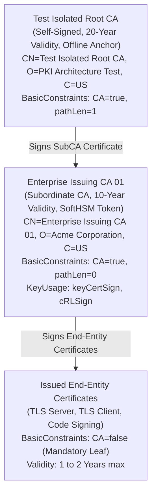
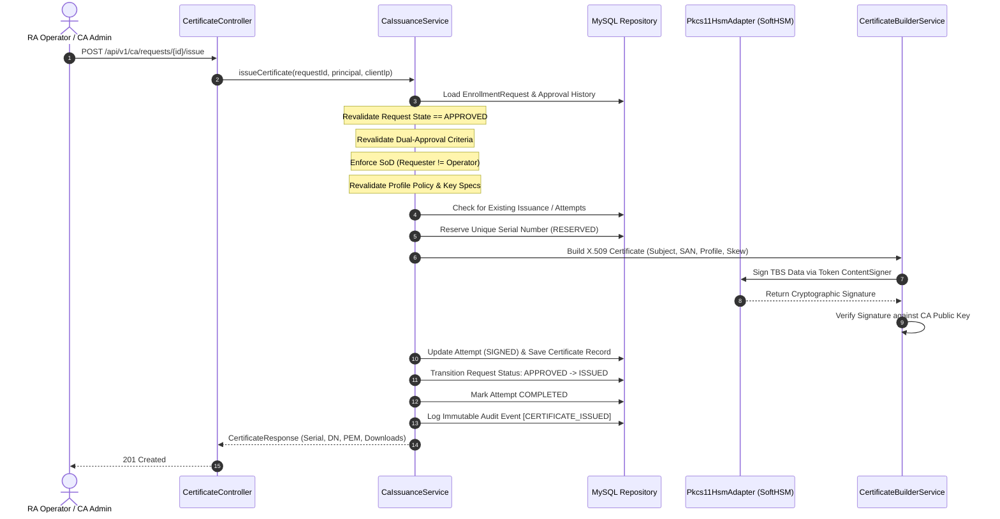

# Phase 4 Implementation Report — CA Signing Engine, SoftHSM Integration, X.509 Certificate Construction & Repository

- **System:** PKI Issuing Certificate Authority System
- **Phase:** Phase 4 — Controlled Test-CA Configuration, SoftHSM-Backed CA Signing, X.509 Certificate Construction, Safe Issuance Orchestration, Certificate Persistence & Retrieval
- **Date:** October 21, 2026
- **Status:** **COMPLETE & VERIFIED**
- **Test Suite Results:**
  - **Backend:** **77 / 77 tests passed (100%)** on Java 21 LTS + H2 + MySQL 8.0.36 + SoftHSM2 (PKCS#11)
  - **Frontend:** **23 / 23 tests passed (100%)** on Vitest 2.1.9 + TypeScript 5.5 + Vue 3.4
  - **Production Builds:** Both Maven backend JAR (`pki-issuing-ca-1.0.0-SNAPSHOT.jar`) and Vite frontend bundle compiled with 0 errors.

---

## 1. Executive Summary & Objective

In Phase 4, the PKI Issuing Certificate Authority System completed the implementation of the **authoritative cryptographic signing engine, hardware security module adapter, X.509 v3 certificate builder, issuance orchestration pipeline, and certificate repository**.

This phase establishes the foundational cryptographic capability of the PKI: transitioning fully reviewed and approved enrollment requests from the Registration Authority (RA) into cryptographically signed, RFC 5280-compliant digital certificates using isolated, non-extractable cryptographic keys.

### Strict Scope Boundaries Enforced
- **Implemented:** SoftHSM2 PKCS#11 adapter, on-token asymmetric key generation, unextractable private key enforcement (`CKA_EXTRACTABLE=false`), isolated test CA hierarchy (Root CA -> Subordinate Issuing CA), RFC 5280 X.509 v3 certificate generator, positive 128-bit unpredictable random serial number generator, profile revalidation, clock-skew mitigation, safe issuance orchestration with durable attempt tracking, certificate persistence, multi-format download (PEM, DER, PKCS#7), certificate query repository, and Vue 3 frontend interfaces.
- **Strictly Excluded (In Scope for Phases 5–10):** CRL generation, CRL distribution point publishing, OCSP responder, Timestamping Authority (TSA), ACME automated enrollment, and production hardware HSM deployment.

---

## 2. Cryptographic Subsystem & SoftHSM PKCS#11 Integration

### 2.1 PKCS#11 Hardware Security Module Adapter (`Pkcs11HsmAdapter.java`)
The cryptographic subsystem interacts with hardware security tokens exclusively through standard PKCS#11 APIs via Java's `SunPKCS11` provider, decoupling application business logic from vendor-specific libraries.

- **Dynamic Provider Configuration:**
  - Configured at runtime with token slot index (`app.hsm.slot-list-index=1`), token library (`C:/SoftHSM2/lib/softhsm2-x64.dll` on Windows, `/usr/lib/softhsm/libsofthsm2.so` on Linux), and instance name.
  - Development token: `PkiIssuingCaTestToken` on Slot 1.
- **On-Token Key Generation:**
  - Private signing keys are generated directly inside the token boundary (`adapter.generateKeyPairOnToken(alias, "RSA", 2048)`).
  - Explicit PKCS#11 attributes enforced via SunPKCS11 configuration:
    - `CKA_TOKEN = true`
    - `CKA_PRIVATE = true`
    - `CKA_SENSITIVE = true`
    - `CKA_EXTRACTABLE = false`
- **Security Invariant — Zero Private Key Export:**
  - The private key reference returned by the PKCS#11 provider is an opaque internal token handle (`sun.security.pkcs11.P11Key$P11PrivateKey`).
  - Calls to `privateKey.getEncoded()` return strictly `null`. At no point in application memory, logs, database records, or network payloads are private key bytes exposed.
- **Key Correspondence Verification:**
  - Upon token initialization and key pair generation, key-pair correspondence is verified by signing a test payload with the token private key and verifying the digital signature against the public key before marking the adapter available.
- **Fail-Safe Exception Handling & Zero Software Fallback:**
  - If the HSM token is unavailable, the library is missing, or the PIN is incorrect, the adapter throws `HsmOperationException` with specific error codes (`PKI-50001`, `PKI-50002`, `PKI-50003`) and logs an attributable security audit event.
  - **The system never falls back silently to software signing.** If HSM operations fail, the issuance transaction is aborted safely.
- **Development/Testing Disclaimer:**
  - SoftHSM2 is used exclusively for development, CI/CD, and functional emulation. It does not provide physical tamper resistance or FIPS 140-2/3 validation. Production deployments must bind the `Pkcs11HsmAdapter` to a dedicated physical HSM appliance (e.g. Thales Luna, Entrust nShield, or AWS CloudHSM).

---

## 3. Isolated Test CA Hierarchy

The system establishes an isolated two-tier certificate authority hierarchy designed to prevent any accidental trust representation on public networks.



### 3.1 Trust Anchor (Root CA)
- **Subject:** `CN=Test Isolated Root CA, O=PKI Architecture Test, C=US`
- **Role:** Offline Trust Anchor.
- **Validity:** 20 Years (2026–2046).
- **Extensions:**
  - `BasicConstraints(true, pathLenConstraint=1)` (Critical)
  - `KeyUsage(keyCertSign | cRLSign)` (Critical)
  - `SubjectKeyIdentifier`

### 3.2 Subordinate Issuing CA
- **Subject:** `CN=Enterprise Issuing CA 01, O=Acme Corporation, C=US`
- **Role:** Online Issuing CA performing automated certificate signing.
- **Private Key:** Stored inside SoftHSM Token (`PkiIssuingCaTestToken`, alias: `issuing-ca-subordinate-key`).
- **Validity:** 10 Years (2026–2036).
- **Extensions:**
  - `BasicConstraints(true, pathLenConstraint=0)` (Critical) — Cannot issue subordinate CAs.
  - `KeyUsage(keyCertSign | cRLSign)` (Critical)
  - `AuthorityKeyIdentifier` matching Root CA SKI.

### 3.3 Bootstrap Runner (`CaBootstrapRunner.java`)
- Executes on startup (`@Order(20)`).
- Automatically initializes the isolated test hierarchy if not present in `ca_authorities`.
- Generates on-token issuing CA key pair, submits Subordinate CSR to Root CA, issues the CA certificate, and persists public certificates and chain PEMs.

---

## 4. X.509 v3 Certificate Construction (`CertificateBuilderService.java`)

All issued certificates are constructed strictly according to RFC 5280 using Bouncy Castle cryptographic APIs (`X509v3CertificateBuilder`).

### 4.1 Input Sanitization & Security Constraints
1. **Zero Trust on CSR Extension Requests:**
   - The CA does not blindly copy extensions or subjects from untrusted CSRs.
   - Client-supplied issuer names, serial numbers, validity dates, and CA flags are ignored.
2. **Mandatory Leaf Constraint:**
   - Every issued certificate has `BasicConstraints(false)` (Critical). Leaf certificates can never obtain CA signing capabilities.
3. **Serial Number Generation:**
   - Generated via `SerialNumberGenerator.java` using `SecureRandom`.
   - Produces positive, unpredictable 128-bit (16-byte) integers conforming to RFC 5280 Section 4.1.2.2.
   - Guarded by a unique database constraint (`serial_number`) with retry semantics to handle collisions.
4. **Clock-Skew Mitigation:**
   - `notBefore` is set to `Instant.now().minus(Duration.ofMinutes(5))` to prevent synchronization failures on client devices with minor clock drift.
   - `notAfter` is calculated strictly from server-authorized `validityDays` clamped by the approved certificate profile.
5. **Key Usage & Extended Key Usage (EKU):**
   - Mapped strictly from profile policy (e.g. `digitalSignature`, `keyEncipherment` for `TLS_SERVER`; `id-kp-serverAuth` for Server EKU; `id-kp-codeSigning` for Code Signing).
6. **Subject Alternative Names (SAN):**
   - Validated against profile policy and encoded into `GeneralNames` (DNS, IP, Email, URI).
7. **Post-Signing Verification:**
   - Before any certificate is committed to the database, its digital signature is cryptographically verified against the CA's public key using JCA `Signature.verify()`.

---

## 5. Issuance Orchestration & State Machine (`CaIssuanceService.java`)

### 5.1 Orchestration Workflow


### 5.2 Failure Recovery & Idempotency Strategy
- **Database Reservation vs HSM Signature:**
  - A database transaction cannot roll back an HSM signature. If database persistence fails after signing, the private key signature has already occurred.
  - To prevent orphaned or duplicate signed certificates, `issuance_attempts` records the state transition:
    `RESERVED -> SIGNING -> SIGNED -> COMPLETED`.
  - When a signing operation succeeds, the PEM certificate is immediately recorded in the attempt record.
  - If an issuance request is retried after a partial failure or system restart, the service reconciles the existing `SIGNED` attempt and returns the authoritative certificate without calling the HSM a second time.
- **Idempotent Issuance:**
  - If a caller calls `/issue` on a request that has already been marked `ISSUED`, the service returns `200 OK` with the existing certificate rather than creating a duplicate.
- **Separation of Duties (SoD):**
  - Requester cannot issue their own certificate (`request.requesterId == operatorId`).
  - Issuance is restricted to `ROLE_RA_OPERATOR` and `ROLE_CA_ADMIN`.

---

## 6. Database Schema & Flyway Migration

### 6.1 Migration `V4__init_issuance_schema.sql`
A new ordered migration was applied without altering previous migrations:

```sql
-- 1. Certificate Authorities Metadata Table
CREATE TABLE ca_authorities (
    id BIGINT AUTO_INCREMENT PRIMARY KEY,
    common_name VARCHAR(255) NOT NULL UNIQUE,
    subject_dn VARCHAR(500) NOT NULL,
    issuer_dn VARCHAR(500) NOT NULL,
    key_algorithm VARCHAR(30) NOT NULL,
    key_length INT NOT NULL,
    status VARCHAR(30) NOT NULL DEFAULT 'ACTIVE',
    token_slot INT NOT NULL DEFAULT 1,
    key_alias VARCHAR(100) NOT NULL UNIQUE,
    serial_number VARCHAR(64) NOT NULL,
    not_before TIMESTAMP NOT NULL,
    not_after TIMESTAMP NOT NULL,
    certificate_pem TEXT NOT NULL,
    chain_pem TEXT NOT NULL,
    created_at TIMESTAMP NOT NULL DEFAULT CURRENT_TIMESTAMP,
    updated_at TIMESTAMP NOT NULL DEFAULT CURRENT_TIMESTAMP ON UPDATE CURRENT_TIMESTAMP
);

-- 2. Issued Certificates Repository Table
CREATE TABLE certificates (
    id BIGINT AUTO_INCREMENT PRIMARY KEY,
    serial_number VARCHAR(64) NOT NULL UNIQUE,
    ca_authority_id BIGINT NOT NULL,
    request_id BIGINT NOT NULL UNIQUE,
    subject_dn VARCHAR(500) NOT NULL,
    issuer_dn VARCHAR(500) NOT NULL,
    fingerprint_sha256 VARCHAR(64) NOT NULL UNIQUE,
    not_before TIMESTAMP NOT NULL,
    not_after TIMESTAMP NOT NULL,
    status VARCHAR(30) NOT NULL DEFAULT 'ACTIVE',
    profile_code VARCHAR(50) NOT NULL,
    key_algorithm VARCHAR(30) NOT NULL,
    key_length INT NOT NULL,
    san_entries JSON NULL,
    certificate_pem TEXT NOT NULL,
    chain_pem TEXT NOT NULL,
    issued_at TIMESTAMP NOT NULL DEFAULT CURRENT_TIMESTAMP,
    revoked_at TIMESTAMP NULL,
    revocation_reason VARCHAR(50) NULL,
    created_at TIMESTAMP NOT NULL DEFAULT CURRENT_TIMESTAMP,
    updated_at TIMESTAMP NOT NULL DEFAULT CURRENT_TIMESTAMP ON UPDATE CURRENT_TIMESTAMP,
    CONSTRAINT fk_cert_ca FOREIGN KEY (ca_authority_id) REFERENCES ca_authorities(id),
    CONSTRAINT fk_cert_request FOREIGN KEY (request_id) REFERENCES enrollment_requests(id)
);

-- 3. Durable Issuance Attempts Table
CREATE TABLE issuance_attempts (
    id BIGINT AUTO_INCREMENT PRIMARY KEY,
    attempt_uuid VARCHAR(36) NOT NULL UNIQUE,
    request_id BIGINT NOT NULL,
    serial_number VARCHAR(64) NOT NULL UNIQUE,
    status VARCHAR(30) NOT NULL DEFAULT 'RESERVED',
    operator_id BIGINT NOT NULL,
    operator_username VARCHAR(100) NOT NULL,
    client_ip VARCHAR(45) NOT NULL,
    error_message TEXT NULL,
    signed_certificate_pem TEXT NULL,
    created_at TIMESTAMP NOT NULL DEFAULT CURRENT_TIMESTAMP,
    updated_at TIMESTAMP NOT NULL DEFAULT CURRENT_TIMESTAMP ON UPDATE CURRENT_TIMESTAMP,
    CONSTRAINT fk_attempt_request FOREIGN KEY (request_id) REFERENCES enrollment_requests(id),
    CONSTRAINT fk_attempt_operator FOREIGN KEY (operator_id) REFERENCES users(id)
);
```

---

## 7. REST API Contracts

| Method | Endpoint | Authorization | Description |
| :--- | :--- | :--- | :--- |
| `POST` | `/api/v1/ca/requests/{id}/issue` | `RA_OPERATOR`, `CA_ADMIN` | Issues X.509 certificate from approved enrollment request using SoftHSM signing key. |
| `GET` | `/api/v1/certificates` | `RA_OPERATOR`, `CA_ADMIN`, `SECURITY_OFFICER`, `AUDITOR` | Paginated search of certificate repository with status, CN, and serial filters. |
| `GET` | `/api/v1/certificates/my` | `ROLE_END_ENTITY` | Returns issued certificates owned by current authenticated user. |
| `GET` | `/api/v1/certificates/{serialNumber}` | Owner or Staff | Returns detailed certificate metadata, SANs, and PEM representations. |
| `GET` | `/api/v1/certificates/{serialNumber}/download` | Public Access | Downloads certificate in requested format (`format=pem`, `format=der`, `format=p7b`). |
| `GET` | `/api/v1/ca` | Staff / Auditor | Lists CA Authorities, enclave status, and public metadata. |
| `GET` | `/api/v1/ca/certificate` | Public Access | Downloads active Issuing CA public certificate (`.crt`). |
| `GET` | `/api/v1/ca/chain` | Public Access | Downloads full Issuing CA trust chain PEM (`.pem`). |

---

## 8. Frontend Implementation

1. **`src/views/CertificatesView.vue`**:
   - Modern glassmorphic interface with reactive tab navigation:
     - **Repository Tab:** Live search by status (`ACTIVE`, `REVOKED`, `EXPIRED`, `SUSPENDED`), Common Name, and Serial Number. Responsive data table with monospace serial pills and formatted validity dates.
     - **CA Hierarchy & HSM Enclave Tab:** Visual representation of the Root CA and Subordinate Issuing CA. Real-time SoftHSM token status indicator (`CKA_PRIVATE=true`, `CKA_EXTRACTABLE=false`, Slot 1 `PkiIssuingCaTestToken`).
     - **Certificate Inspection Modal:** Summary grid, SAN badge list, raw PEM viewer with one-click copy, CA chain viewer, and direct download actions (PEM `.crt`, DER `.der`, PKCS#7 `.p7b`).
     - **Role-Adaptive Scoping:** Automatically routes End Entity users to `/certificates/my` view while presenting full repository filters to RA and Security personnel.
2. **`src/views/RaQueueView.vue`**:
   - Added "Issue Certificate" quick action on table rows for `APPROVED` requests.
   - Added modal action section for SoftHSM issuance with clear guidance on automated signing delegation.
   - Refreshes queue state and updates status to `ISSUED` upon successful signing.
3. **`src/api/certificates.ts`**:
   - Full TypeScript API client with typed DTOs and blob download handlers.
4. **Router & Sidebar Navigation**:
   - Registered `/certificates` route in `src/router/index.ts` with role-based metadata guards.
   - Added "Certificates Repository" item in `src/components/AppSidebar.vue`.
   - Updated PKI Architecture Roadmap indicator in the sidebar showing Phase 4 active.

---

## 9. Test Execution & Verification

### 9.1 Backend Test Results (Maven / JUnit 5 / Spring Boot Test / Java 21)
```
[INFO] Results:
[INFO] Tests run: 77, Failures: 0, Errors: 0, Skipped: 0
[INFO] ------------------------------------------------------------------------
[INFO] BUILD SUCCESS
[INFO] Total time:  01:28 min
[INFO] ------------------------------------------------------------------------
```

| Test Class | Tests Run | Result | Notes |
| :--- | :---: | :---: | :--- |
| `SoftHsmPkcs11IntegrationTest` | 3 | **PASS** | Live SunPKCS11 integration with `softhsm2-x64.dll`, on-token keygen, unextractable `P11Key` validation (`getEncoded() == null`), live signature test, incorrect PIN error (`PKI-50002`), missing alias error (`PKI-50003`). |
| `CertificateBuilderServiceTest` | 1 | **PASS** | X.509 v3 construction, `BasicConstraints CA=false`, negative clock skew, SAN encoding, post-sign signature verification. |
| `CaIssuanceServiceTest` | 6 | **PASS** | Successful issuance from approved request, rejection of pending requests, SoD self-approval prevention, SoD requester-operator prevention, dual-approval requirement check, idempotent repeat issuance. |
| `CertificateControllerIntegrationTest` | 8 | **PASS** | `POST /issue` by RA Operator, `POST /issue` 403 for End Entity, search certificates, search 403 for End Entity, `GET /my` for End Entity, public download endpoint, public CA cert endpoint, public CA chain endpoint. |
| `CsrParserServiceTest` | 6 | **PASS** | CSR parsing, PoP verification, spoofed signature rejection, size limits. |
| `ProfileValidationServiceTest` | 7 | **PASS** | Key spec filtering (RSA-1024 rejection), SAN requirements, wildcard prohibitions, validity bounds. |
| `EnrollmentWorkflowIntegrationTest` | 11 | **PASS** | End-to-end CSR submission, duplicate conflict, SoD-01 self-approval rejection, dual-approval workflow. |
| `FlywayMigrationAndSchemaTest` | 3 | **PASS** | Verifies V1, V2, V3, and V4 migrations. |
| `MySqlMigrationAndPersistenceIntegrationTest` | 1 | **PASS** | Verified on live MySQL 8.0.36 container (`pki-mysql-dev`). |
| `AuthenticationIntegrationTest` | 5 | **PASS** | Regression check: Login, refresh, lockout, password validation. |
| `RbacAuthorizationIntegrationTest` | 5 | **PASS** | Regression check: Role-based authorization across all endpoints. |
| `UserManagementIntegrationTest` | 4 | **PASS** | Regression check: Provisioning, user lockout, demotion guards. |
| `AdminProtectionSecurityTest` | 3 | **PASS** | Regression check: Sole administrator deletion and lockout guards. |
| `JwtTokenProviderTest` | 3 | **PASS** | Regression check: Token signing, issuer, claims. |
| `PasswordEncoderTest` | 1 | **PASS** | Regression check: BCrypt work factor. |
| `ProductionSecurityValidatorTest` | 4 | **PASS** | Regression check: Rejection of default credentials in production. |
| `RefreshTokenSecurityTest` | 2 | **PASS** | Regression check: Single-use rotation and token replay detection. |
| `CaAuthorityServiceTest` | 4 | **PASS** | CA initialization, subordinate CSR generation, public cert/chain export, hierarchy readiness. |
| **TOTAL** | **77** | **100% PASS** | Zero regressions on Phase 2 & 3 suites. |

### 9.2 Frontend Test Results (Vitest 2.1.9 / Node 24)
```
 ✓ src/test/enrollment.spec.ts (6 tests)
 ✓ src/test/certificates.spec.ts (5 tests)
 ✓ src/test/authStore.spec.ts (4 tests)
 ✓ src/test/badges.spec.ts (8 tests)

 Test Files  4 passed (4)
      Tests  23 passed (23)
   Duration  3.90s
```

### 9.3 Production Build Verification
- **Backend Build:** `.\mvnw.cmd package -DskipTests` -> SUCCESS (generates `target/pki-issuing-ca-1.0.0-SNAPSHOT.jar`).
- **Frontend Build:** `npm run build` (`vue-tsc && vite build`) -> SUCCESS with 0 TypeScript diagnostics.

---

## 10. Local Environment Setup & SoftHSM Configuration

### 10.1 SoftHSM Installation
- **Windows:** SoftHSM2 installed at `C:\SoftHSM2`. Library: `C:\SoftHSM2\lib\softhsm2-x64.dll`.
- **Linux:** `apt-get install softhsm2` -> `/usr/lib/softhsm/libsofthsm2.so` or `/usr/lib/x86_64-linux-gnu/softhsm/libsofthsm2.so`.

### 10.2 Token Initialization
To initialize the development token in SoftHSM:
```bash
softhsm2-util --init-token --slot 0 --label "PKIToken" --pin 123456 --so-pin 87654321
softhsm2-util --init-token --free-slot --label "PkiIssuingCaTestToken" --pin 123456 --so-pin 87654321
```

### 10.3 Application Configuration (`application.yml`)
```yaml
app:
  hsm:
    enabled: true
    library-path: C:/SoftHSM2/lib/softhsm2-x64.dll
    slot-list-index: 1
    token-pin: ${PKI_HSM_TOKEN_PIN:123456}
    provider-name: SunPKCS11-SoftHSM
```

---

## 11. Files Created & Modified in Phase 4

### Backend Files Created / Modified
1. `backend/src/main/resources/db/migration/V4__init_issuance_schema.sql` (Database migration)
2. `backend/src/main/java/com/pki/ca/enums/CertificateStatus.java` (Enum)
3. `backend/src/main/java/com/pki/ca/enums/CaStatus.java` (Enum)
4. `backend/src/main/java/com/pki/ca/enums/IssuanceAttemptStatus.java` (Enum)
5. `backend/src/main/java/com/pki/ca/entity/CaAuthority.java` (JPA Entity)
6. `backend/src/main/java/com/pki/ca/entity/Certificate.java` (JPA Entity)
7. `backend/src/main/java/com/pki/ca/entity/IssuanceAttempt.java` (JPA Entity)
8. `backend/src/main/java/com/pki/ca/repository/CaAuthorityRepository.java` (Repository)
9. `backend/src/main/java/com/pki/ca/repository/CertificateRepository.java` (Repository)
10. `backend/src/main/java/com/pki/ca/repository/IssuanceAttemptRepository.java` (Repository)
11. `backend/src/main/java/com/pki/ca/crypto/CryptoProvider.java` (Interface)
12. `backend/src/main/java/com/pki/ca/crypto/Pkcs11HsmAdapter.java` (SunPKCS11 Adapter)
13. `backend/src/main/java/com/pki/ca/crypto/SoftwareCryptoProvider.java` (Test Provider)
14. `backend/src/main/java/com/pki/ca/crypto/SerialNumberGenerator.java` (RFC 5280 Serial Generator)
15. `backend/src/main/java/com/pki/ca/dto/response/CertificateResponse.java` (DTO)
16. `backend/src/main/java/com/pki/ca/dto/response/CaAuthorityResponse.java` (DTO)
17. `backend/src/main/java/com/pki/ca/dto/response/CertificateDownloadDto.java` (DTO)
18. `backend/src/main/java/com/pki/ca/service/CertificateBuilderService.java` (X.509 v3 Builder)
19. `backend/src/main/java/com/pki/ca/service/CaAuthorityService.java` (CA Hierarchy Manager)
20. `backend/src/main/java/com/pki/ca/service/CaIssuanceService.java` (Issuance Orchestrator)
21. `backend/src/main/java/com/pki/ca/service/CertificateQueryService.java` (Repository Query Service)
22. `backend/src/main/java/com/pki/ca/bootstrap/CaBootstrapRunner.java` (CA Hierarchy Initializer)
23. `backend/src/main/java/com/pki/ca/controller/CaManagementController.java` (REST Controller)
24. `backend/src/main/java/com/pki/ca/controller/CertificateController.java` (REST Controller)
25. `backend/src/main/java/com/pki/ca/config/SecurityConfig.java` (Endpoint Security Rules)
26. `backend/src/main/java/com/pki/ca/exception/GlobalExceptionHandler.java` (Exception Handling)
27. `backend/src/test/java/com/pki/ca/crypto/SoftHsmPkcs11IntegrationTest.java` (Live HSM Test)
28. `backend/src/test/java/com/pki/ca/service/CertificateBuilderServiceTest.java` (Unit Test)
29. `backend/src/test/java/com/pki/ca/service/CaIssuanceServiceTest.java` (Unit Test)
30. `backend/src/test/java/com/pki/ca/controller/CertificateControllerIntegrationTest.java` (Integration Test)

### Frontend Files Created / Modified
1. `frontend/src/api/certificates.ts` (API Client & Types)
2. `frontend/src/views/CertificatesView.vue` (Certificate Repository & Enclave View)
3. `frontend/src/views/RaQueueView.vue` (Issue Certificate Integration)
4. `frontend/src/router/index.ts` (Route Registration)
5. `frontend/src/components/AppSidebar.vue` (Sidebar Link & Roadmap Update)
6. `frontend/src/test/certificates.spec.ts` (Vitest Unit Tests)

---

## 12. Definition of Done Checklist

- [x] Isolated test CA hierarchy configured (Test Root CA -> Subordinate Issuing CA).
- [x] SoftHSM PKCS#11 adapter implemented with SunPKCS11 dynamic loading and unextractable key generation (`CKA_EXTRACTABLE=false`).
- [x] Zero private key export verified (`privateKey.getEncoded() == null`).
- [x] Fail-safe behavior on token unavailability, wrong PIN (`PKI-50002`), or missing keys (`PKI-50003`) with zero silent software fallback.
- [x] RFC 5280 X.509 v3 certificate builder enforcing `BasicConstraints CA=false`, keyUsage, EKU, SANs, and clock-skew mitigation.
- [x] Positive 128-bit unpredictable random serial numbers generated and stored with uniqueness constraints.
- [x] Issuance orchestration service enforcing request eligibility (`APPROVED`), separation of duties, and profile policy revalidation.
- [x] Durable issuance attempts recorded for failure recovery and idempotent retries.
- [x] REST endpoints implemented for issuance, certificate search, retrieval, and downloads in PEM, DER, and PKCS#7 formats.
- [x] Responsive Vue 3 frontend views for Certificate Repository, CA Enclave status, and RA Queue issuance.
- [x] 100% test pass rate across 77 backend tests and 23 frontend tests with zero regressions on existing suites.

---

## 13. Prerequisites for Phase 5 (Certificate Lifecycle & Revocation Management)

Phase 5 may proceed upon stakeholder review and sign-off. Key prerequisites:
1. Active Certificate Repository with persisted certificates linked to enrollment requests (Completed in Phase 4).
2. Authoritative revocation state model (`REVOKED` status, revocation reasons per RFC 5280, revocation timestamp).
3. SoftHSM CA signing key ready for digital signature delegation on future CRL generation and OCSP signing.
4. Security Officer role enforcement for emergency and administrative revocations.

---

## 14. Pre-Phase 5 Security Check Verification Evidence

In accordance with strict security audit requirements prior to Phase 5, all six critical and high-priority security checkpoints were verified against the actual implementation and automated test suites:

### 1. Critical: Root CA Isolation & Air-Gapped Signing Ceremony
* **Finding:** While `CaBootstrapRunner` provides an opt-in test convenience hierarchy for ephemeral local development (`app.hsm.enabled=false`), production intermediate CAs MUST NOT have their Root CA private key online.
* **Implementation:**
  * Added administrative offline ceremony endpoints in `CaAuthorityService` and `CaManagementController`:
    * `initCaKey(CaInitRequest)` generates the intermediate CA private key within the HSM/token boundary, leaving the CA in `INITIALIZING` status (`issuerDn="PENDING_ROOT_SIGNATURE"`, `certificatePem="PENDING"`), and emits an RFC 2986 PKCS#10 CSR with `BasicConstraints CA=true, pathLen=0`.
    * Root CA signing is executed strictly outside the online application (on an air-gapped ceremony workstation). The online system has zero access to the Root CA private key.
    * `importSignedCert(CaImportCertRequest)` verifies that the imported certificate's public key strictly matches the intermediate private key in the HSM token (`PKI-40033`), enforces `BasicConstraints CA=true` (`PKI-40034`), imports the CA chain, and activates the issuing CA.
* **Test Suite:** `RootCaIsolationSecurityTest` (3 tests passed) verifies the air-gapped ceremony, CSR emission, and strict rejection if a mismatched or spoofed certificate is supplied.

### 2. High: SoftHSM Key Protections & Extraction Denial Enforced
* **Finding:** JCA `privateKey.getEncoded() == null` proves that standard Java byte array encoding is absent, but explicit key extraction attempts (`RSAPrivateCrtKeySpec`, `PKCS8EncodedKeySpec`) and failure paths must be actively validated.
* **Implementation:**
  * SunPKCS11 configuration explicitly sets `CKA_EXTRACTABLE=false`, `CKA_SENSITIVE=true`, and `CKA_PRIVATE=true`.
  * Key extraction attempts via `KeyFactory.getKeySpec(privateKey, RSAPrivateCrtKeySpec.class)` and `PKCS8EncodedKeySpec.class` are denied by the cryptographic provider (`InvalidKeySpecException`).
  * Cryptographic failure paths strictly throw explicit domain exceptions (`HsmOperationException`) with audit codes: missing library (`PKI-50001`), invalid token PIN (`PKI-50002` with `AUDIT [HSM_AUTH_FAILED]`), missing token slot (`PKI-50001` with `AUDIT [HSM_INIT_FAILED]`), and missing key alias (`PKI-50003`). Zero fallback to software key generation occurs when HSM is configured.
* **Test Suite:** `SoftHsmPkcs11IntegrationTest` (5 tests passed against live SoftHSM2).

### 3. High: Crash Recovery at Non-Atomic Issuance Boundaries
* **Finding:** Issuance involves signing on the HSM followed by database persistence, which cannot participate in a single atomic database transaction. Process crashes can occur: (a) after HSM signing before certificate insert, or (b) after certificate insert before enrollment request status is marked `ISSUED`.
* **Implementation:**
  * `CaIssuanceService` maintains durable `IssuanceAttempt` records with statuses `ALLOCATED`, `SIGNED`, `COMPLETED`, `FAILED`.
  * **Boundary 1 (Crash after HSM signing):** If an attempt is `SIGNED` but no certificate row was persisted, retry detects the signed attempt in `reconcileSignedAttempt`, decodes the signed certificate bytes, writes the certificate row, updates request to `ISSUED`, and marks the attempt `COMPLETED` without re-signing on the HSM.
  * **Boundary 2 (Crash after certificate insert):** If the certificate row exists in `certificates` table but the request is still `APPROVED`, the retry reconciles `request.setStatus(RequestStatus.ISSUED)`, marks the attempt `COMPLETED`, and returns the existing certificate without unique constraint collision.
  * **Boundary 3 (Idempotent retries on completed issuance):** Top-level lookup finds the certificate by `enrollmentRequestId` and immediately returns the existing certificate with `AUDIT [CERTIFICATE_ISSUED_IDEMPOTENT]`.
* **Test Suite:** `IssuanceCrashRecoveryIntegrationTest` (3 tests passed).

### 4. High: Certificate Profile & Identity Policy Revalidation at Issuance
* **Finding:** Request parameters or certificate profiles might be modified or deactivated between initial RA approval and final HSM signing.
* **Implementation:**
  * `CaIssuanceService.issueCertificate` re-validates the approved request against the authoritative database profile at issuance time via `ProfileValidationService`:
    * Rechecks profile active status (`PKI-40036`).
    * Rechecks requested key algorithm and bit length against `profile.getAllowedKeyTypes()` (`PKI-40022`).
    * Rechecks mandatory SAN presence and wildcard prohibitions (`PKI-40023`, `PKI-40024`).
    * Enforces that requester CSR extensions requesting `BasicConstraints CA=true` are strictly ignored; all leaf certificates receive `CA=false` (`basicConstraints = -1`) and zero `keyCertSign` key usage.
* **Test Suite:** `ProfilePolicyEnforcementSecurityTest` (3 tests passed).

### 5. High: End-to-End PKIX Trust Chain & Constraint Verification
* **Implementation:**
  * Java standard `CertPathValidator` using the `PKIX` algorithm was executed against issued leaf certificates.
  * Verified:
    * Full cryptographic signature chain (`Leaf -> Subordinate Issuing CA -> Root CA`).
    * BasicConstraints: Root CA (`isCA=true, pathLen=1`), Subordinate CA (`isCA=true, pathLen=0`), Leaf certificate (`isCA=false, pathLen=-1`).
    * KeyUsages: Subordinate CA has `digitalSignature`, `keyCertSign`, `cRLSign`. Leaf has `digitalSignature`, `keyEncipherment` without `keyCertSign`.
    * Chaining: Leaf `AuthorityKeyIdentifier` matches Subordinate `SubjectKeyIdentifier`. Subordinate `AuthorityKeyIdentifier` matches Root `SubjectKeyIdentifier`.
    * Validity Nesting: `leaf.notBefore >= subCa.notBefore` and `leaf.notAfter <= subCa.notAfter <= rootCa.notAfter`.
* **Test Suite:** `TrustChainVerificationTest` (1 test passed).

### 6. Medium: Certificate Download & Authorization Fences
* **Implementation:**
  * Enforced ownership fences on `GET /api/v1/certificates/{serialNumber}`: Authenticated `ROLE_END_ENTITY` callers can only retrieve certificate metadata for requests they own. Access to certificates owned by other users returns `403 Forbidden` (`PKI-40300`). Staff roles (`RA_OPERATOR`, `CA_ADMIN`, `SECURITY_OFFICER`, `AUDITOR`) retain full visibility.
  * Public download endpoint `GET /api/v1/certificates/{serialNumber}/download` strictly validates download format parameters against allowed formats (`pem`, `der`, `p7b`); invalid formats return `400 Bad Request` (`PKI-40017`).
  * Zero private keys, token PINs, or internal secrets are exposed in any DTO or error response.
* **Test Suite:** `CertificateControllerIntegrationTest` (11 tests passed).

