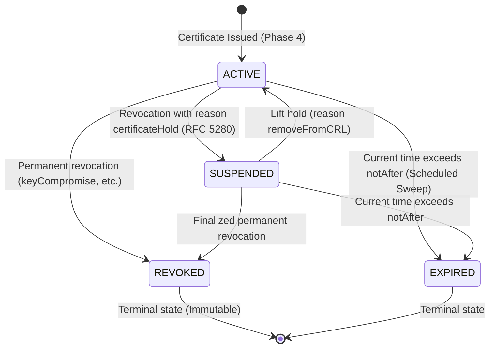

# Phase 5 Implementation Plan — Certificate Lifecycle, Revocation Management, CRL Publication & OCSP Responder

- **System:** PKI Issuing Certificate Authority System
- **Phase:** Phase 5 — Certificate Lifecycle & Revocation Subsystem
- **Standards:** RFC 5280, RFC 6960, NIST SP 800-57, PKCS#11 v2.40, OWASP ASVS v4.0.3
- **Author:** Senior PKI Architect & Cryptographic Security Engineer
- **Status:** **APPROVED FOR IMPLEMENTATION**
- **Date:** October 26, 2026

---

## 1. Executive Summary & Objective

Phase 5 introduces comprehensive, production-grade **Certificate Lifecycle Management, Standardized Revocation, X.509 v2 CRL Generation and Publication, and RFC 6960 OCSP Responder Services** on top of the established Phase 1–4 foundational architecture.

This phase guarantees that relying parties, administrators, and end entities can reliably verify the trust and validity status of any certificate issued by the Subordinate Issuing CA in real time through standards-compliant cryptographic protocols.

### Key Scope Areas
1. **Scope A — Certificate Lifecycle:**
   - Querying and filtering with authorization scoping.
   - Status tracking (`ACTIVE`, `SUSPENDED`, `REVOKED`, `EXPIRED`).
   - Timezone-safe, idempotent scheduled expiration detection via a controllable `Clock`.
   - Renewal workflow through existing enrollment/RA approval with cryptographic linkage (`renewedFrom` / `renewedTo`).
2. **Scope B — Revocation Management:**
   - Standardized RFC 5280 revocation reason mapping (`unspecified`, `keyCompromise`, `cACompromise`, `affiliationChanged`, `superseded`, `cessationOfOperation`, `certificateHold`, `privilegeWithdrawn`).
   - Role-based authorization & separation of duties (owners can request, security officers / CA admins execute).
   - Concurrency control and idempotency (repeat revocations cannot overwrite historical timestamps or reasons).
   - Protection against accidental CA certificate revocation via end-entity workflow.
3. **Scope C — X.509 v2 CRL Generation & Publication:**
   - Authoritative generation signed exclusively by the issuing CA's HSM key (`Pkcs11HsmAdapter`).
   - Zero software signing fallback; fails safe if HSM is unreachable.
   - Monotonically increasing CRL numbers with persistent concurrency guards.
   - Retention of historical CRLs and public publication endpoints (`application/pkix-crl`).
4. **Scope D — RFC 6960 OCSP Responder:**
   - Standards-compatible parsing and response generation for GET and POST requests.
   - Explicit distinction between `GOOD`, `REVOKED`, and `UNKNOWN` (absence from DB returns `UNKNOWN`, never false `GOOD`).
   - In-memory freshness caching with immediate eviction on revocation.
   - Safe failure handling (`TRY_LATER` / `INTERNAL_ERROR` when HSM or database fails).
5. **Scope E — REST API & Frontend Experience:**
   - Clean REST endpoints following established DTO patterns and Spring Security role guards.
   - Reactive Vue 3 + TypeScript interfaces for certificate inspection, renewal, revocation modal, CRL administration, and OCSP health monitoring.
6. **Scope F — Database & Audit:**
   - Flyway migration `V5__init_revocation_and_crl_schema.sql`.
   - Durable audit event persistence with structured audit logs.

---

## 2. Invariants & Security Controls

1. **Zero Private Key Exposure:**
   - CA private keys remain within the SoftHSM / PKCS#11 token boundary (`CKA_EXTRACTABLE=false`).
   - All CRL and OCSP response signatures utilize `CryptoProvider.createContentSigner()`.
2. **Offline Root Isolation:**
   - The Root CA remains completely offline and unconfigured in the online application.
   - The Subordinate CA signs all leaf certificates, CRLs, and OCSP responses (or delegates OCSP signing).
3. **Separation of Duties (SoD):**
   - End entities can only request revocation or renewal for certificates they own.
   - Security Officers and CA Admins can execute direct revocation and generate CRLs.
   - RA Operators cannot revoke CA certificates.
4. **Fail-Safe Revocation Verification:**
   - If the database or HSM is unavailable, OCSP must respond with `TRY_LATER` (3) or `INTERNAL_ERROR` (2). It must **never** falsely return `GOOD`.
   - Clients must never receive a CRL advertised as current until its entire signed artifact is committed to storage.
5. **Monotonic CRL Counter:**
   - CRL numbers are strictly monotonic positive integers. Concurrency locks ensure that two concurrent generation triggers cannot emit duplicate or descending CRL numbers.

---

## 3. Database Migration Strategy (`V5__init_revocation_and_crl_schema.sql`)

### Changes to Existing Tables
1. `certificates`:
   - `revoked_at DATETIME NULL`
   - `revocation_reason VARCHAR(50) NULL`
   - `revocation_invalidity_date DATETIME NULL`
   - `renewed_from_serial VARCHAR(64) NULL`
   - `renewed_to_serial VARCHAR(64) NULL`
   - Indexes on `idx_cert_revoked_at` and `idx_cert_renewed_from`.
2. `enrollment_requests`:
   - `renewed_certificate_serial VARCHAR(64) NULL`

### New Tables
1. `revocation_records`:
   - Authoritative record of every revocation event with actor attribution, CRL reason code, invalidity date, and justification comments.
   - Unique constraint on `serial_number`.
2. `crl_records`:
   - Durable storage of generated X.509 v2 CRL artifacts (DER binary blob + PEM string), monotonic CRL number, validity window (`thisUpdate`, `nextUpdate`), and revoked entry count.
   - Unique constraint on `(ca_id, crl_number)`.
3. `crl_sequences`:
   - Persistent atomic sequence and locking table per CA authority for monotonic CRL numbering.
4. `audit_events`:
   - Durable audit table for security-critical lifecycle events with chained hashes.

---

## 4. State Transitions & Finite State Machines

### 4.1 Certificate Lifecycle FSM

### 4.2 Revocation Reason Mapping (RFC 5280 §5.3.1)
| Internal Reason Code | RFC 5280 CRLReason Code | Description | Allowed for Leaf |
| :--- | :---: | :--- | :---: |
| `UNSPECIFIED` | 0 | Reason not explicitly specified | Yes |
| `KEY_COMPROMISE` | 1 | Private key known or suspected compromised | Yes |
| `CA_COMPROMISE` | 2 | CA private key compromised (Protected workflow only) | Special |
| `AFFILIATION_CHANGED` | 3 | Subject's name or identity attributes changed | Yes |
| `SUPERSEDED` | 4 | Certificate replaced by a newer certificate | Yes |
| `CESSATION_OF_OPERATION` | 5 | Service or device retired from service | Yes |
| `CERTIFICATE_HOLD` | 6 | Temporary suspension of certificate validity | Yes |
| `PRIVILEGE_WITHDRAWN` | 9 | Assigned privileges or authorizations revoked | Yes |
| `REMOVE_FROM_CRL` | 8 | Only valid on Delta CRLs or lifting certificateHold | Special |

---

## 5. Subsystems Architecture

### 5.1 Subsystem 1: Lifecycle & Scheduled Expiration (`CertificateLifecycleService.java`)
- Injectable `Clock` bean allowing deterministic testing of past/future time boundaries.
- Scheduled task (`@Scheduled(cron = "${app.lifecycle.expiration-cron:0 0 * * * *}")`) queries:
  `SELECT c FROM Certificate c WHERE c.status = 'ACTIVE' AND c.notAfter < :now`
- Idempotently marks status as `EXPIRED` and dispatches `AUDIT [CERTIFICATE_EXPIRED]`.
- Invariant: A certificate is **never** marked `EXPIRED` before its `notAfter` timestamp.

### 5.2 Subsystem 2: Revocation Management (`RevocationService.java`)
- `revokeCertificate(serialNumber, requestDto, principal, clientIp)`:
  1. Load `Certificate` by serial under pessimistic/optimistic lock.
  2. Verify actor permissions: owner of certificate, OR roles `SECURITY_OFFICER`, `CA_ADMIN`, `RA_OPERATOR`.
  3. Validate certificate is not a CA certificate (prevent end-entity revocation of issuing CA).
  4. If already `REVOKED`, verify idempotency: return existing revocation details without modifying original timestamp or reason.
  5. If reason is `CERTIFICATE_HOLD`, transition status to `SUSPENDED`; otherwise transition to `REVOKED`.
  6. Insert `RevocationRecord` into database.
  7. Evict certificate serial from OCSP cache.
  8. Log audit event `AUDIT [CERTIFICATE_REVOKED]` or `AUDIT [CERTIFICATE_SUSPENDED]`.
- `unholdCertificate(serialNumber, principal, clientIp)`:
  1. Verify certificate is `SUSPENDED`.
  2. Verify actor has `ROLE_SECURITY_OFFICER` or `ROLE_CA_ADMIN`.
  3. Transition status back to `ACTIVE`, remove revocation record or mark cleared.
  4. Evict from OCSP cache.
  5. Log audit event `AUDIT [CERTIFICATE_UNHELD]`.

### 5.3 Subsystem 3: Certificate Renewal (`CertificateRenewalService.java`)
- `requestRenewal(serialNumber, renewalDto, principal, clientIp)`:
  1. Load existing certificate and verify current status (`ACTIVE` or nearing expiration within configured threshold).
  2. Verify requester owns the certificate or has RA/Admin role.
  3. Revalidate CSR: parse new CSR (proof-of-possession verification), ensure distinct key pair is supplied unless policy explicitly permits key reuse.
  4. Verify CSR Subject DN matches original certificate subject DN.
  5. Verify requested SANs conform to the active profile policy.
  6. Create `EnrollmentRequest` flagged with `renewedCertificateSerial = serialNumber`.
  7. When the new certificate is subsequently issued, update `renewed_to_serial` on the old certificate and `renewed_from_serial` on the new certificate.
  8. Log audit event `AUDIT [CERTIFICATE_RENEWAL_REQUESTED]`.

### 5.4 Subsystem 4: X.509 v2 CRL Generation Engine (`CrlService.java`)
- `generateCrl(caId, operator, clientIp)`:
  1. Acquire atomic sequence lock in `crl_sequences`. Increment `last_crl_number` by 1.
  2. Query all active revocations for the CA authority from `revocation_records`.
  3. Build `X509v2CRLBuilder`:
     - Issuer: CA Subject DN
     - `thisUpdate`: `Instant.now().minus(Duration.ofMinutes(5))` (clock skew mitigation)
     - `nextUpdate`: `Instant.now().plus(Duration.ofHours(ca.getCrlValidityHours()))`
     - Extension: `CRLNumber` (monotonically increasing value)
     - Extension: `AuthorityKeyIdentifier` derived from CA's SKI or public key.
     - For each revoked record: add entry with serial number, revocation date, and `ReasonCode` extension.
  4. Sign CRL using HSM `ContentSigner`:
     `ContentSigner signer = cryptoProvider.createContentSigner(ca.getHsmKeyAlias(), "SHA256withRSA");`
     `X509CRLHolder crlHolder = crlBuilder.build(signer);`
  5. Verify CRL signature against CA public key before committing.
  6. Store DER bytes and PEM in `crl_records`.
  7. Disclose new CRL as current.
  8. Log audit event `AUDIT [CRL_GENERATED]: CRL #{} for CA '{}'`.
- Download endpoints:
  - `GET /api/v1/crl/download` or `GET /api/v1/ca/crl` -> Returns latest CRL in DER (`application/pkix-crl`).
  - `GET /api/v1/ca/crl/pem` -> Returns latest CRL in PEM.
  - `GET /api/v1/crl/{crlNumber}/download` -> Historical CRL archive download.

### 5.5 Subsystem 5: RFC 6960 OCSP Responder (`OcspResponderService.java`)
- Endpoints:
  - `POST /api/v1/ocsp` (`Content-Type: application/ocsp-request`)
  - `GET /api/v1/ocsp/{base64Request}`
- Processing Pipeline:
  1. Validate incoming payload size (reject requests > 16 KB).
  2. Parse `OCSPReq` using Bouncy Castle.
  3. Extract `Req` and `CertID`.
  4. Validate `CertID`:
     - Match issuer name hash and issuer key hash against configured CA.
     - If issuer is not recognized: return `BasicOCSPResp` with `UnknownStatus()`.
  5. Query `Certificate` and `RevocationRecord` by serial:
     - If not found in database: return `UnknownStatus()`. (Never return GOOD for unissued serials).
     - If found in `RevocationRecord`: return `RevokedStatus(revocationDate, crlReasonCode)`.
     - If `Certificate.status == SUSPENDED`: return `RevokedStatus` with reason `certificateHold`.
     - If `Certificate.status == ACTIVE`: return `CertificateStatus.GOOD`.
     - If `Certificate.status == EXPIRED`: return `CertificateStatus.GOOD` with respect to revocation status per RFC 6960 (or `Revoked` if revoked prior to expiration).
  6. Assemble `BasicOCSPRespBuilder`:
     - `RespID`: Responder name matching CA Subject DN.
     - `producedAt`: current instant.
     - Add SingleResponse with `thisUpdate` (now minus 5 min), `nextUpdate` (now + 24 hours).
     - Handle OCSP Nonce: if client request has `OCSPObjectIdentifiers.id_pkix_ocsp_nonce`, echo nonce into single/response extension.
  7. Sign response using CA HSM key (or delegated OCSP key):
     `ContentSigner signer = cryptoProvider.createContentSigner(ca.getHsmKeyAlias(), "SHA256withRSA");`
  8. Wrap in `OCSPRespBuilder.build(OCSPRespBuilder.SUCCESSFUL, basicResp)`.
  9. Response caching:
     - Set HTTP headers `Cache-Control: public, max-age=300, must-revalidate`.
     - Internal fast cache with serial eviction upon revocation.
  10. Failure modes:
      - Malformed ASN.1: return HTTP 200 with `OCSPResp(OCSPRespBuilder.MALFORMED_REQUEST)`.
      - HSM offline / Internal failure: return HTTP 200 with `OCSPResp(OCSPRespBuilder.TRY_LATER)` or `INTERNAL_ERROR`.

---

## 6. API Contracts

| Method | Endpoint | Authorization | Description |
| :--- | :--- | :--- | :--- |
| `POST` | `/api/v1/certificates/{serial}/revoke` | Owner or Staff | Revoke or suspend certificate with RFC 5280 reason |
| `POST` | `/api/v1/certificates/{serial}/unhold` | Security / CA Admin | Lift temporary certificate hold |
| `POST` | `/api/v1/certificates/{serial}/renew` | Owner or Staff | Submit renewal enrollment request |
| `GET` | `/api/v1/crl/current` | Public Access | Download authoritative X.509 v2 CRL (DER format) |
| `GET` | `/api/v1/ca/crl` | Public Access | Standard CRL distribution point (DER format) |
| `GET` | `/api/v1/ca/crl/pem` | Public Access | Standard CRL distribution point (PEM format) |
| `GET` | `/api/v1/crl/history` | Staff / Auditor | List historical generated CRL metadata |
| `POST` | `/api/v1/crl/generate` | Security / CA Admin | Trigger emergency or manual CRL generation |
| `POST` | `/api/v1/ocsp` | Public Access | RFC 6960 OCSP request handler (binary POST) |
| `GET` | `/api/v1/ocsp/{base64Request}` | Public Access | RFC 6960 OCSP request handler (HTTP GET) |
| `GET` | `/api/v1/ocsp/status` | Staff / Auditor | OCSP service health, signer info, and metrics |
| `GET` | `/api/v1/certificates/{serial}/audit` | Staff / Auditor | View full lifecycle audit history of certificate |

---

## 7. Frontend Integration

1. **`src/views/CertificatesView.vue`**:
   - Add Revocation badge and details to Certificate Inspection modal.
   - Display renewal linkages: "Renewed From" and "Renewed To" serial pills.
   - Add "Revoke Certificate" action with dedicated modal (reason selection, confirmation).
   - Add "Renew Certificate" action initiating renewal workflow.
   - Add "CRL & Revocation Management" tab:
     - Displays latest CRL number, issue date, next update, count of revoked certificates.
     - "Generate New CRL" action button for Security Officers / Admins.
     - Download CRL buttons for DER and PEM.
     - Historical CRL generation log table.
     - OCSP responder health badge & operational status card.
2. **`src/api/certificates.ts`**:
   - Add TypeScript endpoints for revoke, unhold, renew, CRL status, CRL generation, OCSP status.
3. **Role Guards**:
   - End Entity users only see Revoke/Renew on their own certificates.
   - CRL generation restricted to `ROLE_SECURITY_OFFICER` and `ROLE_CA_ADMIN`.

---

## 8. Test Plan & Matrix

1. **Database Migration Test (`FlywayMigrationAndSchemaTest`)**:
   - Verify V1, V2, V3, V4, and V5 migrations execute cleanly on clean schema.
2. **Revocation Service Tests (`RevocationServiceTest` & `RevocationIntegrationTest`)**:
   - Authorized revocation by owner, Security Officer, and CA Admin.
   - Rejection of revocation by unauthorized third-party user (`403 Forbidden`).
   - Idempotent repeated revocation (original timestamp & reason preserved).
   - Rejection of CA certificate revocation via end-entity workflow.
   - Reason code mapping to RFC 5280 X.509 CRLReason.
   - Temporary hold and unhold transitions.
3. **CRL Generation & Cryptographic Verification (`CrlServiceTest`)**:
   - CRL signed by issuing CA key using SoftHSM / PKCS#11.
   - Cryptographic signature validation against CA public key.
   - Correct issuer DN, thisUpdate, nextUpdate, CRLNumber, and AKI extensions.
   - Monotonic CRL numbering under sequential and concurrent calls.
   - Inclusion of revoked serial numbers with revocation dates and reason codes.
   - Excluded active certificates from CRL.
   - Zero software signing fallback when HSM is unavailable (throws exception, does not publish).
4. **OCSP Responder Tests (`OcspResponderTest`)**:
   - Query ACTIVE certificate -> returns `GOOD`.
   - Query REVOKED certificate -> returns `REVOKED` with accurate date and reason.
   - Query non-existent serial number -> returns `UNKNOWN` (never false `GOOD`).
   - Query with unknown issuer hash -> returns `UNKNOWN`.
   - Client nonce preservation.
   - Cache invalidation on revocation.
   - HSM failure during OCSP signing -> returns `TRY_LATER` or `INTERNAL_ERROR`.
   - HTTP GET and POST protocol validation with Bouncy Castle OCSP client.
5. **Renewal Workflow Tests (`CertificateRenewalTest`)**:
   - Renewal with new CSR passes validation and inherits identity.
   - Linking of `renewed_from_serial` and `renewed_to_serial`.
   - Rejection of unauthorized renewal.
6. **Expiration Scheduler Tests (`CertificateLifecycleTest`)**:
   - Test clock manipulation: certificates before `notAfter` remain `ACTIVE`.
   - Certificates after `notAfter` transition to `EXPIRED`.
   - Idempotent execution.
7. **Security Regression Suite**:
   - Run complete suite (Phase 2 Auth/RBAC, Phase 3 Enrollment/CSR, Phase 4 Issuance/HSM/Trust-Chain).
8. **Frontend Test Suite**:
   - Vitest unit tests for renewal, revocation modal, badges, and CRL view.

---

## 9. Implementation Roadmap

- **Step 1:** Create Flyway Migration `V5__init_revocation_and_crl_schema.sql`.
- **Step 2:** Implement domain entities, enums, and repositories (`RevocationRecord`, `CrlRecord`, `CrlSequence`, `AuditEvent`, `RevocationReasonCode`).
- **Step 3:** Implement Certificate Expiration Lifecycle Scheduler with controllable `Clock`.
- **Step 4:** Implement Revocation Service (authorization, idempotency, concurrency, audit).
- **Step 5:** Implement Certificate Renewal Service & Enrollment linkage.
- **Step 6:** Implement X.509 v2 CRL Generation and Publication Service backed by `CryptoProvider`.
- **Step 7:** Implement RFC 6960 OCSP Responder Service.
- **Step 8:** Implement REST Controllers, DTOs, and Security Configuration for public/protected endpoints.
- **Step 9:** Implement Frontend UI components and API client.
- **Step 10:** Run comprehensive tests (unit, integration, cryptographic, frontend), verify builds, and produce report.
